# UML Class Diagram Handbook

> **Purpose:** A practical foundation for learning and teaching UML Class Diagrams through consistent **Zoo Management** and **Online Shopping** examples.
>
> **Scope:** Classes, objects, attributes, operations, visibility, abstract classes, generalization, association, aggregation, composition, multiplicity, navigability, modeling workflow, review guidance, exercises, and teaching notes.

---

## 1. Learning Objectives

After completing this handbook, learners should be able to:

1. Explain what a UML Class Diagram represents.
2. Distinguish a class from an object or instance.
3. Read and write class names, attributes, and operations.
4. Interpret public, private, protected, and package visibility.
5. Model generalization, association, aggregation, and composition.
6. Read multiplicities at both ends of an association.
7. Distinguish structural meaning from implementation detail.
8. Build and review a small Class Diagram.
9. Recognize common mistakes, especially misuse of aggregation and composition.

---

## 2. What Is a Class Diagram?

A UML Class Diagram describes the **static structure** of a system. It presents:

- the important classes or types in the system;
- the data each class owns;
- the behavior each class provides;
- the structural relationships among classes;
- constraints such as multiplicity and navigability.

A Class Diagram answers questions such as:

1. What concepts exist in the system?
2. What information does each concept own?
3. What operations can each concept perform?
4. How are the concepts related?
5. How many instances may participate in each relationship?

It does **not** normally show the runtime order of calls. Sequence and timing belong in behavioral diagrams such as Sequence Diagrams or Activity Diagrams.

### 2.1. High-Level Map

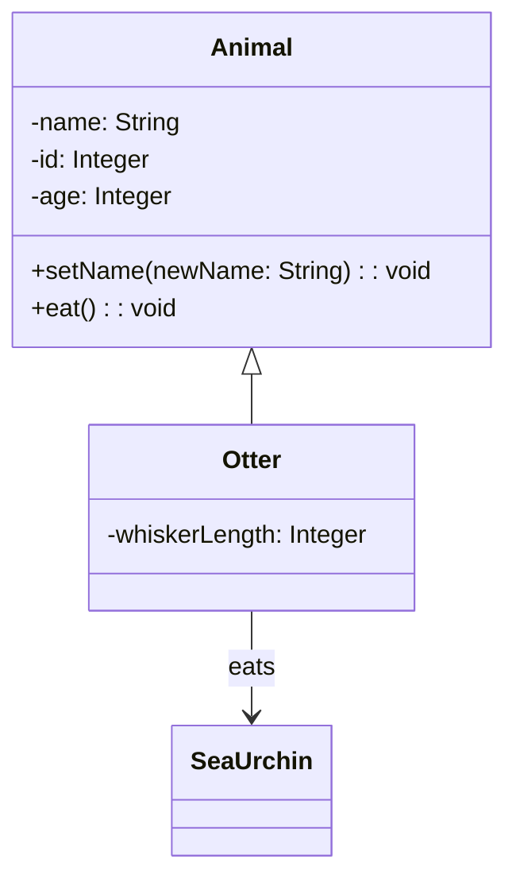

This small diagram already contains the main ideas:

- classes;
- attributes;
- operations;
- visibility;
- generalization;
- association.

---

## 3. Anatomy of a Class

A class is commonly drawn as a rectangle with up to three compartments:

1. **Class name**
2. **Attributes**
3. **Operations**

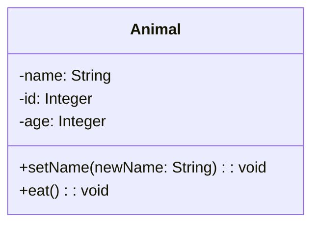

### 3.1. Class Name

The top compartment contains the class name.

Recommended convention:

- use a singular noun;
- use `PascalCase`;
- choose a meaningful domain concept.

Examples:

- `Animal`
- `Employee`
- `VisitorCenter`
- `ShoppingCart`
- `OrderDetail`

Avoid names such as `Data`, `ManagerThing`, or `ProcessObject` unless they genuinely express a domain concept.

### 3.2. Class versus Object

A **class** defines a type. An **object** is a specific instance of that class.

Example:

- Class: `Animal`
- Object: an animal named Ruth with ID `304` and age `114`

A Class Diagram primarily models classifiers such as classes. A specific object snapshot belongs in an **Object Diagram**.

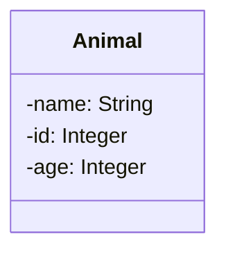

Example instance, expressed textually:

```text
ruth: Animal
name = "Ruth"
id = 304
age = 114
```

---

## 4. Attributes

An attribute represents a structural property of a class. It describes information held by instances of that class.

General UML form:

```text
visibility name: Type = defaultValue
```

Examples:

```text
-name: String
-id: Integer
-age: Integer
-status: AccountStatus
```

### 4.1. Attribute Naming

Recommended conventions:

- begin with a lowercase letter;
- use `camelCase` for multiword names;
- choose a specific type;
- avoid duplicating information that can be derived safely.

### 4.2. The Animal Example


The attributes can describe an individual animal instance:

- `name = "Ruth"`
- `id = 304`
- `age = 114`

### 4.3. Attribute or Association?

Use an attribute for a value-like property:

```text
-name: String
-dateOfBirth: Date
```

Use an association when another important domain class participates:

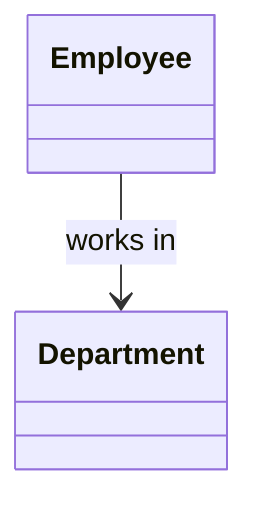

Avoid hiding an important structural relationship inside an attribute such as:

```text
-departmentId: Integer
```

when the model needs to reason about `Department` as a class.

---

## 5. Operations

An operation represents behavior offered by a class.

General UML form:

```text
visibility operationName(parameterName: Type): ReturnType
```

Examples:

```text
+setName(newName: String): void
+eat(): void
+verifyLogin(password: String): Boolean
+updatePhoneNumber(newNumber: String): void
```

### 5.1. Animal Operations


### 5.2. Parameters and Return Types

Parentheses identify an operation. Parameters are optional and appear inside them.

```text
+setName(newName: String): void
```

This operation:

- is public;
- is named `setName`;
- accepts `newName` of type `String`;
- returns no value.

### 5.3. Operation versus Method

Strictly speaking:

- an **operation** is the behavioral feature declared by the classifier;
- a **method** is an implementation of that operation.

The terms are often used informally as synonyms, but the distinction is useful in precise UML work.

---

## 6. Visibility

Visibility controls where a class member may be referenced.

| Symbol | UML visibility | Typical meaning                                                       |
| ------ | -------------- | --------------------------------------------------------------------- |
| `+`    | Public         | Visible to any client with access to the class                        |
| `-`    | Private        | Visible only within the owning class                                  |
| `#`    | Protected      | Visible to the class and its descendants, subject to language mapping |
| `~`    | Package        | Visible within the same package                                       |

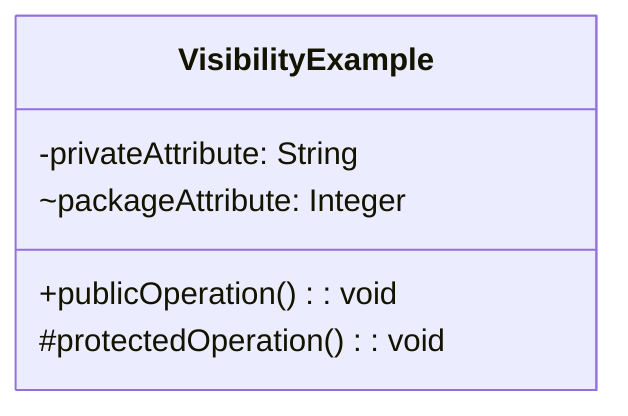

### 6.1. Practical Default

A common starting point is:

- keep mutable state private;
- expose behavior intentionally through public operations;
- use protected members sparingly;
- do not add getters and setters mechanically if they weaken the model's invariants.

Visibility is a design decision, not merely formatting.

---

## 7. Worked Class Example: Employee

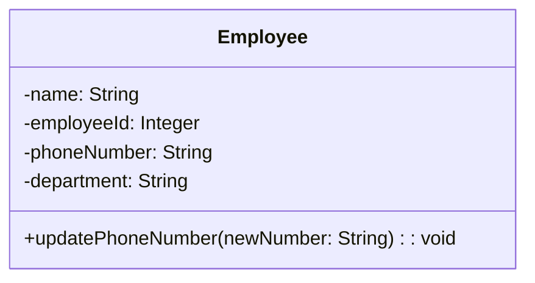

Review questions:

- Does `Employee` represent a meaningful concept?
- Are the attributes necessary to the current model?
- Should `Department` remain a string or become a class?
- Does updating a phone number belong to `Employee`?
- Are the selected member visibilities intentional?

A richer structural model may replace the `department: String` attribute with an association:

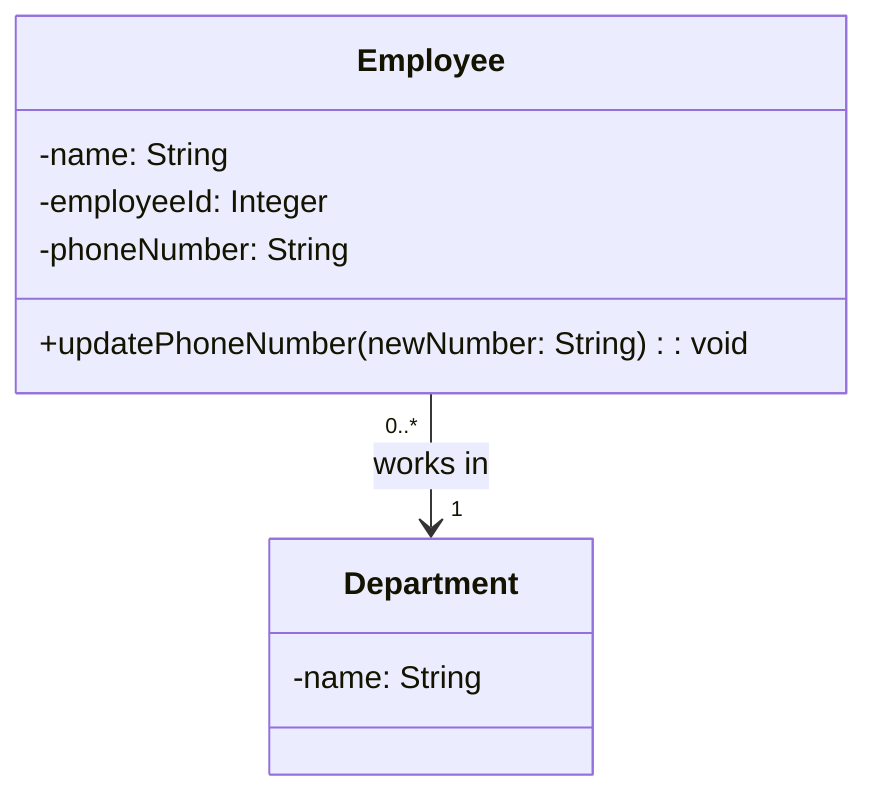

---

## 8. Relationships Overview

This handbook covers these structural relationships:

1. Generalization
2. Association
3. Shared aggregation
4. Composition
5. Dependency, as an important additional distinction

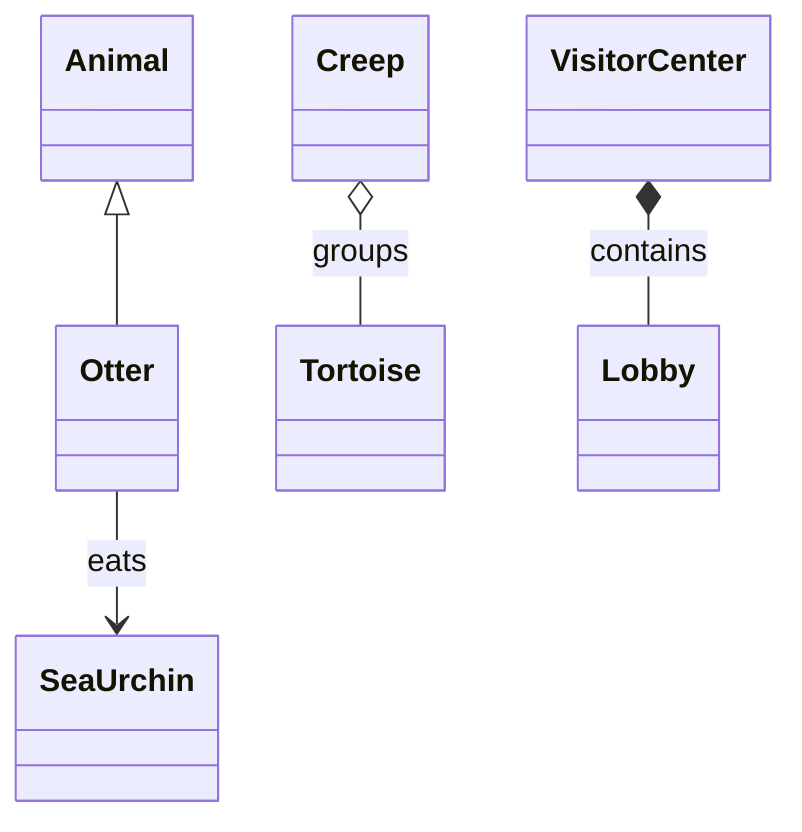

---

## 9. Generalization and Inheritance

Generalization expresses an **is-a** relationship between a specialized classifier and a more general classifier.

- `Otter` is an `Animal`.
- `Tortoise` is an `Animal`.
- `SlowLoris` is an `Animal`.

The hollow triangle points to the **general** class.

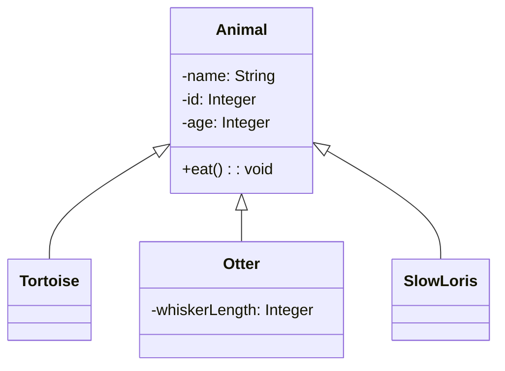

### 9.1. What Is Inherited?

The specialized classes inherit applicable structural and behavioral features specified by the general class. They may also add specialized features.

For example, `Otter` inherits the general animal features and adds `whiskerLength`.

### 9.2. Generalization Test

Use generalization only when both statements are valid:

1. The specialized class **is a kind of** the general class.
2. Instances of the specialized class can be used wherever the general type is expected without violating its contract.

Do not use inheritance only to reuse code. Delegation or composition may express the design more accurately.

---

## 10. Abstract Classes

An abstract class defines shared structure or behavior but is not intended to be instantiated directly.

In UML, an abstract class name is conventionally written in _italics_. The constraint `{abstract}` may also be used.

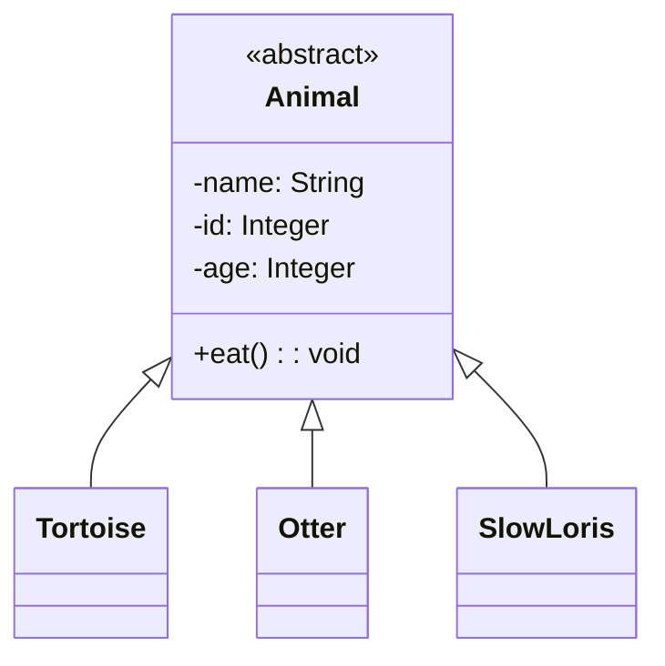

In this model, the system creates concrete animals such as `Tortoise`, `Otter`, or `SlowLoris`, not a generic `Animal` instance.

> **Caution:** “Avoid repeating code” may be a benefit, but the semantic reason for an abstract superclass is that it represents a valid shared abstraction.

---

## 11. Association

An association represents a structural relationship between classifiers. A plain line is the basic notation.

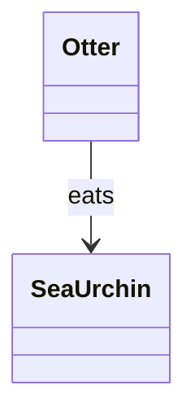

### 11.1. Association Name

The relationship may be given a verb phrase such as `eats`, `owns`, `works in`, or `places`.

### 11.2. Navigability

An arrowhead may show navigability when it matters to the model.

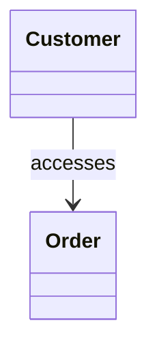

Do not confuse navigability with multiplicity:

- navigability answers **which direction can be traversed or referenced**;
- multiplicity answers **how many instances may participate**.

### 11.3. Role Names

Association ends may be named to clarify the role played by related objects.

Example:

```text
Customer 1 -------- 0..* Order
                 orders
```

---

## 12. Shared Aggregation

Shared aggregation is a specialized association shown with a **hollow diamond** at the aggregate end.

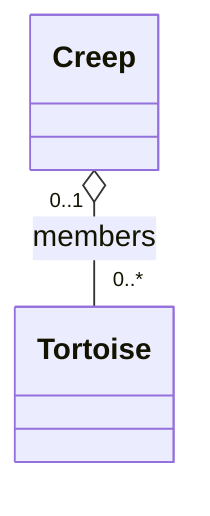

The transcript's example describes a group of tortoises, called a `Creep`. A tortoise may belong to a group while still existing independently.

### 12.1. Important Caution

The semantics of shared aggregation are intentionally weak in UML and are often interpreted inconsistently. A plain association is frequently sufficient.

Do not use a hollow diamond merely to mean:

- “has-a”;
- “contains a collection”;
- “the part can exist independently.”

Use shared aggregation only when the aggregate semantics add real value and are understood consistently by the team.

---

## 13. Composition

Composition is a strong whole-part association shown with a **filled diamond** at the composite end.

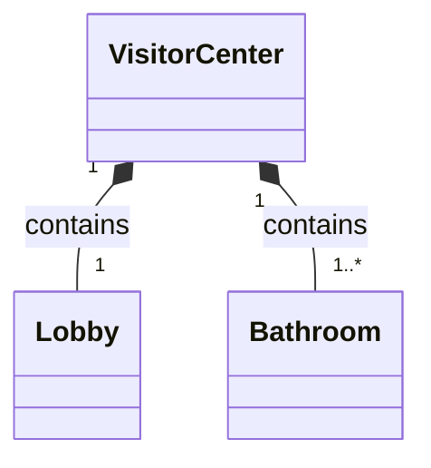

### 13.1. Composition Semantics

A composite part:

- belongs to at most one composite at a time;
- is governed by the composite's ownership boundary;
- normally has a lifecycle tied to the composite in the model.

The Visitor Center example treats its `Lobby` and `Bathroom` instances as owned parts.

### 13.2. Do Not Reduce Composition to Deletion

“Delete the whole, delete the part” is a useful introductory intuition, but it is not the complete semantic definition.

Before using composition, ask:

1. Is the part exclusively owned by one whole at a time?
2. Is the part's identity meaningful within that whole?
3. Does the whole govern creation, transfer, or destruction of the part?
4. Would shared ownership contradict the domain?

If these answers are unclear, use a plain association until ownership semantics are established.

---

## 14. Aggregation versus Composition

| Question                       | Shared aggregation                 | Composition                         |
| ------------------------------ | ---------------------------------- | ----------------------------------- |
| Notation                       | Hollow diamond                     | Filled diamond                      |
| Ownership strength             | Weak or shared aggregate semantics | Strong composite ownership          |
| Part shared by multiple wholes | May be possible                    | At most one composite at a time     |
| Lifecycle governed by whole    | Not necessarily                    | Normally yes in the model           |
| Recommended usage              | Sparingly                          | Only with clear ownership semantics |

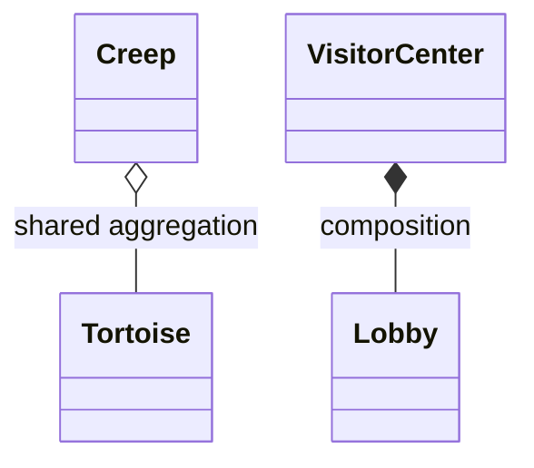

---

## 15. Multiplicity

Multiplicity defines how many instances may participate at an association end.

Common forms:

| Multiplicity  | Meaning         |
| ------------- | --------------- |
| `1`           | Exactly one     |
| `0..1`        | Zero or one     |
| `*` or `0..*` | Zero or many    |
| `1..*`        | One or many     |
| `m..n`        | A bounded range |

### 15.1. Visitor Center Example


Read the model carefully:

- each `VisitorCenter` has exactly one `Lobby`;
- each `Lobby` belongs to one `VisitorCenter`;
- each `VisitorCenter` has one or more `Bathroom` instances;
- each `Bathroom` belongs to one `VisitorCenter`.

### 15.2. Read the Opposite End

To read multiplicity, stand at one class and look at the multiplicity written near the other class.

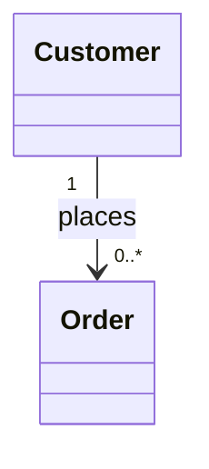

This means:

- one `Customer` may place zero or many `Order` instances;
- each `Order` belongs to exactly one `Customer` in this model.

### 15.3. Multiplicity Is a Constraint

Multiplicity should come from domain rules, not from database habits or guesses. If the requirement is unknown, mark it as unresolved rather than inventing a number.

---

## 16. Dependency versus Association

The transcript focuses on associations, but learners should also distinguish a dependency.

- An **association** indicates a structural relationship between instances.
- A **dependency** indicates that one element uses another without necessarily retaining a structural link.

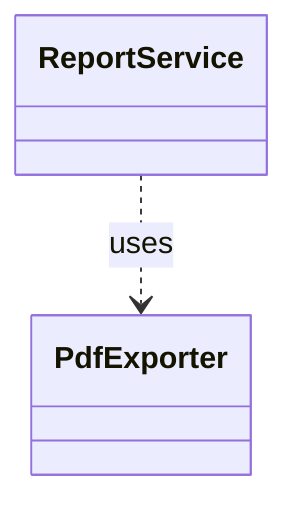

Typical dependency signals include:

- parameter types;
- local variables;
- temporary service use;
- static utility calls.

Do not model every code-level dependency. Include it only when it matters to the design view.

---

## 17. Real-World Example: Online Shopping

### 17.1. User Hierarchy

```mermaid
classDiagram
    class User {
        -userId: Integer
        -password: String
        -loginStatus: Boolean
        -registerDate: Date
        +verifyLogin(password: String): Boolean
    }

    class Customer {
        -customerName: String
        +placeOrder(): Order
    }

    class Administrator {
        +updateCatalog(): void
    }

    User <|-- Customer
    User <|-- Administrator
```

The hollow triangle points to `User`, the general class. `Customer` and `Administrator` inherit applicable features and add specialized behavior.

### 17.2. Customer and Orders

```mermaid
classDiagram
    class Customer {
        -customerName: String
    }

    class Order {
        -orderId: Integer
        -orderDate: Date
        -status: OrderStatus
    }

    Customer "1" --> "0..*" Order : places
```

This model states:

- a customer may have no orders or many orders;
- an order belongs to exactly one customer.

### 17.3. Order and Order Details

```mermaid
classDiagram
    class Order {
        -orderId: Integer
    }

    class OrderDetail {
        -quantity: Integer
        -unitPrice: Decimal
    }

    Order "1" *-- "1..*" OrderDetail : contains
```

This refined model uses one or more order details per order. A one-to-one relationship would usually be suspicious because an order commonly has multiple line items.

### 17.4. Shopping Cart and Cart Items

```mermaid
classDiagram
    class Customer
    class ShoppingCart
    class CartItem {
        -quantity: Integer
    }
    class Product

    Customer "1" *-- "1" ShoppingCart : owns
    ShoppingCart "1" *-- "0..*" CartItem : contains
    CartItem "0..*" --> "1" Product : refers to
```

A cart item is owned by a shopping cart, while the referenced product exists independently.

### 17.5. Shipping Information

Whether `ShippingInfo` should be composition depends on the domain.

```mermaid
classDiagram
    class Order
    class ShippingInfo {
        -recipientName: String
        -addressLine: String
        -postalCode: String
    }

    Order "1" *-- "1" ShippingInfo : delivery details
```

This is reasonable if `ShippingInfo` is an order-specific value snapshot. If the model represents reusable customer addresses, a separate association may be more accurate.

---

## 18. Integrated Online Shopping Diagram

```mermaid
classDiagram
    class User {
        -userId: Integer
        -password: String
        -loginStatus: Boolean
        -registerDate: Date
        +verifyLogin(password: String): Boolean
    }

    class Customer {
        -customerName: String
        +placeOrder(): Order
    }

    class Administrator {
        +updateCatalog(): void
    }

    class ShoppingCart
    class CartItem {
        -quantity: Integer
    }
    class Product {
        -productId: Integer
        -name: String
        -price: Decimal
    }
    class Order {
        -orderId: Integer
        -orderDate: Date
        -status: OrderStatus
    }
    class OrderDetail {
        -quantity: Integer
        -unitPrice: Decimal
    }
    class ShippingInfo

    User <|-- Customer
    User <|-- Administrator
    Customer "1" *-- "1" ShoppingCart : owns
    ShoppingCart "1" *-- "0..*" CartItem : contains
    CartItem "0..*" --> "1" Product : refers to
    Customer "1" --> "0..*" Order : places
    Order "1" *-- "1..*" OrderDetail : contains
    OrderDetail "0..*" --> "1" Product : describes
    Order "1" *-- "1" ShippingInfo : delivery details
    Administrator ..> Product : updates catalog
```

---

## 19. A Repeatable Modeling Workflow

### Step 1: Define the View and Scope

State what the diagram is for:

- conceptual domain model;
- analysis model;
- design model;
- implementation-oriented model.

Do not mix all levels without a clear reason.

### Step 2: Identify Candidate Classes

Look for concepts that have:

- identity;
- state;
- behavior;
- meaningful relationships;
- independent responsibility.

### Step 3: Assign Responsibilities

For each class, ask:

- What information does it own?
- What behavior naturally belongs to it?
- What must it protect as an invariant?

### Step 4: Add Relationships

Start with plain associations. Add stronger notation only when its semantics are justified.

### Step 5: Add Multiplicity

Derive multiplicities from requirements and business rules.

### Step 6: Add Generalization Carefully

Apply the **is-a** and substitutability tests.

### Step 7: Add Visibility and Types

Add implementation-oriented detail only when appropriate to the diagram's purpose.

### Step 8: Review the Model

Check consistency, readability, semantic precision, and traceability to requirements.

---

## 20. Common Modeling Mistakes

### 20.1. Modeling Every Noun as a Class

A noun is only a candidate. It becomes a class when the model needs its identity, state, behavior, or relationships.

### 20.2. Modeling Database Tables Instead of Domain Concepts

A Class Diagram is not automatically an entity-relationship diagram. Persistence concerns may influence design, but the diagrams serve different purposes.

### 20.3. Using Inheritance Only for Code Reuse

Inheritance must express a valid generalization. Prefer delegation or composition if the relationship is not truly **is-a**.

### 20.4. Using Aggregation as Decorative “Has-A”

A hollow diamond adds little when aggregate semantics are unclear. A plain association is often more honest.

### 20.5. Using Composition Only Because Deletion Cascades

Database cascade deletion does not prove UML composition. Composition concerns exclusive whole-part ownership in the model.

### 20.6. Confusing Multiplicity with Navigability

`0..*` does not mean a navigable arrow, and an arrow does not mean many.

### 20.7. Writing Methods without Responsibilities

Do not fill a class with getters, setters, and utility functions merely to populate the operation compartment.

### 20.8. Mixing Abstraction Levels

Avoid placing domain concepts, database adapter classes, UI widgets, and framework utilities in one diagram unless the view explicitly needs them.

### 20.9. Treating Diagram Position as Semantics

Only notation carries semantics. A class placed above another class is not automatically its parent.

### 20.10. Guessing Multiplicities

Unknown multiplicity is a requirements issue, not an invitation to assume `1` or `*`.

---

## 21. Review Checklist

### Scope and Purpose

- [ ] The diagram has a stated purpose and abstraction level.
- [ ] All classes belong to the selected scope.
- [ ] Implementation detail is appropriate for the intended audience.

### Classes

- [ ] Class names are singular, meaningful nouns.
- [ ] Each class has a coherent responsibility.
- [ ] Abstract classes are marked clearly.
- [ ] Objects or sample values are not confused with classes.

### Attributes and Operations

- [ ] Attributes represent owned structural properties.
- [ ] Types are meaningful and consistent.
- [ ] Operations represent class responsibilities.
- [ ] Visibility is intentional.
- [ ] Important domain relationships are not hidden as identifier attributes.

### Relationships

- [ ] Every generalization passes the is-a test.
- [ ] Association names and role names are clear where needed.
- [ ] Navigability is shown only when meaningful.
- [ ] Shared aggregation is used sparingly.
- [ ] Composition has clear exclusive ownership semantics.
- [ ] Dependencies are included only when relevant to the view.

### Multiplicity

- [ ] Multiplicity is present where the constraint matters.
- [ ] Both association ends have been read and validated.
- [ ] Values come from requirements or explicit domain rules.

### Readability

- [ ] The diagram can be read at presentation size.
- [ ] Line crossings are limited.
- [ ] Related classes are grouped logically.
- [ ] The diagram is not overloaded with low-value detail.

---

## 22. Practice Exercises

### Exercise 1: Read a Class

Given:

```text
Employee
-----------------------------
-name: String
-employeeId: Integer
-phoneNumber: String
-----------------------------
+updatePhoneNumber(newNumber: String): void
```

Answer:

1. Which members are private?
2. Which member is public?
3. What parameter does the operation accept?
4. What does it return?

### Exercise 2: Select the Relationship

Choose Generalization, Association, Shared Aggregation, Composition, or Dependency:

1. `Otter` is a kind of `Animal`.
2. `Otter` eats `SeaUrchin`.
3. `VisitorCenter` exclusively owns its `Lobby` in the selected model.
4. `ReportService` temporarily uses `PdfExporter`.
5. `Creep` groups tortoises, but tortoises exist independently.

### Exercise 3: Read Multiplicity

Interpret:

```text
Customer "1" -------- "0..*" Order
```

Explain the rule from both directions.

### Exercise 4: Find the Modeling Problem

Review each statement:

1. `Customer <|-- Order`
2. `Order *-- Product`, although products are shared by many orders.
3. `Customer 1 -- 1 Order`, although customers may not have ordered yet.
4. `Employee` has `departmentId: Integer`, but the diagram must explain department membership.

### Exercise 5: Build a Library Class Diagram

Candidate concepts:

- Member
- Librarian
- Book
- BookCopy
- Loan
- Reservation

Requirements:

- A book describes a title.
- A book may have several physical copies.
- A member may have zero or many loans.
- Each loan concerns one book copy.
- A book copy may be on at most one active loan at a time.
- A member may reserve a book title.

Create a diagram with:

- appropriate classes;
- at least one composition candidate;
- multiplicity at each important association end;
- operations only where responsibilities are clear.

---

## 23. Suggested Answers

### Exercise 1

1. `name`, `employeeId`, and `phoneNumber` are private.
2. `updatePhoneNumber` is public.
3. It accepts `newNumber: String`.
4. It returns `void`.

### Exercise 2

1. Generalization
2. Association
3. Composition
4. Dependency
5. Shared aggregation, although a plain association may be sufficient

### Exercise 3

- One customer may have zero or many orders.
- Each order belongs to exactly one customer.

### Exercise 4

1. Incorrect generalization: an order is not a kind of customer.
2. Composition is likely wrong because a product exists independently and may be referenced by many orders.
3. The multiplicity is too restrictive for a customer with no orders and a customer with several orders.
4. Model `Department` as a class and connect it through an association when department membership matters to the view.

### Exercise 5: One Possible Model

```mermaid
classDiagram
    class Member {
        -memberId: Integer
        -name: String
    }
    class Librarian
    class Book {
        -isbn: String
        -title: String
    }
    class BookCopy {
        -barcode: String
        -status: CopyStatus
    }
    class Loan {
        -loanDate: Date
        -dueDate: Date
        +close(returnDate: Date): void
    }
    class Reservation {
        -createdAt: Date
    }

    Book "1" *-- "1..*" BookCopy : copies
    Member "1" --> "0..*" Loan : borrows
    Loan "0..*" --> "1" BookCopy : concerns
    Member "1" --> "0..*" Reservation : makes
    Reservation "0..*" --> "1" Book : reserves
    Librarian ..> Loan : manages
```

The precise status and “active loan” constraint may require a note, invariant, or supporting specification because simple multiplicity alone cannot express time-dependent exclusivity completely.

---

## 24. Teaching Guide

### Recommended Duration

| Activity                               |  Suggested time |
| -------------------------------------- | --------------: |
| Purpose and diagram scope              |      10 minutes |
| Class anatomy                          |      20 minutes |
| Attributes, operations, and visibility |      25 minutes |
| Generalization and abstract classes    |      20 minutes |
| Association and navigability           |      20 minutes |
| Aggregation and composition            |      25 minutes |
| Multiplicity                           |      20 minutes |
| Online Shopping example                |      20 minutes |
| Exercises and review                   |      30 minutes |
| **Total**                              | **170 minutes** |

### Teaching Sequence

1. Start with one class and its three compartments.
2. Distinguish class from object before adding relationships.
3. Teach attributes and operations as responsibility-bearing features.
4. Introduce visibility as access semantics, not decoration.
5. Teach plain association before stronger relationships.
6. Teach generalization with the is-a test.
7. Treat aggregation and composition cautiously.
8. Teach multiplicity by reading both directions aloud.
9. Finish with the Online Shopping model and a learner-built exercise.

### Instructor Prompts

- “Is this a class, an object, or merely a value?”
- “Which class owns this information?”
- “What responsibility justifies this operation?”
- “Is the relationship really is-a?”
- “Could this part belong to two wholes at the same time?”
- “What does the multiplicity mean when read from the opposite end?”
- “Does the diagram show domain structure or implementation structure?”
- “Would a plain association be more precise than aggregation?”

---

## 25. Key Takeaways

1. A Class Diagram models static structure, not runtime sequence.
2. A class defines a type; an object is a specific instance.
3. Class compartments contain the name, attributes, and operations.
4. Visibility symbols communicate access constraints.
5. Generalization must represent a valid is-a relationship.
6. An abstract class represents a shared abstraction that is not directly instantiated.
7. Association is the default structural relationship.
8. Shared aggregation has weak semantics and should be used sparingly.
9. Composition requires clear exclusive whole-part ownership.
10. Multiplicity is a domain constraint and must be read at both ends.
11. Navigability and multiplicity express different concerns.
12. Strong diagrams remain scoped, readable, and traceable to requirements.

---

## 26. Glossary

| Term               | Meaning                                                              |
| ------------------ | -------------------------------------------------------------------- |
| Abstract class     | A class not intended to be instantiated directly                     |
| Association        | A structural relationship among classifiers                          |
| Attribute          | A structural property owned by a classifier                          |
| Class              | A classifier describing a set of instances with shared features      |
| Composition        | A strong whole-part association with exclusive composite ownership   |
| Dependency         | A usage relationship in which one element depends on another         |
| Generalization     | A relationship from a specialized classifier to a general classifier |
| Instance           | A concrete occurrence of a classifier                                |
| Method             | An implementation of an operation                                    |
| Multiplicity       | A constraint on the number of participating instances                |
| Navigability       | Whether an association can be traversed from one end to another      |
| Object             | An instance with identity, state, and behavior                       |
| Operation          | A behavioral feature declared by a classifier                        |
| Shared aggregation | A weak aggregate association shown with a hollow diamond             |
| Visibility         | The accessibility of a model element or feature                      |

---

## Source and Adaptation Note

This handbook was adapted from the UML Class Diagram tutorial transcript supplied by the user. The spoken material was reorganized into a teaching structure and supplemented with Mermaid diagrams, semantic cautions, a modeling workflow, review criteria, exercises, suggested answers, and instructor guidance.

The Zoo and Online Shopping examples remain the instructional backbone. Several explanations were refined where introductory shortcuts could otherwise cause modeling errors, especially around aggregation, composition, abstraction, multiplicity, and the distinction between operations and methods.
