# UML Sequence Diagram Handbook

> **Purpose:** A practical foundation for learning and teaching UML Sequence Diagrams through a consistent **ATM Cash Withdrawal** example.
>
> **Scope:** Participants, actors, lifelines, messages, returns, execution specifications, combined fragments, guards, object creation and destruction, message types, modeling workflow, common mistakes, exercises, and teaching guidance.

---

## 1. Learning Objectives

After completing this handbook, learners should be able to:

1. Explain the purpose and limits of a UML Sequence Diagram.
2. Identify relevant participants for one interaction scenario.
3. Distinguish actors, objects, lifelines, and execution specifications.
4. Read time from top to bottom.
5. Model synchronous, asynchronous, reply, self, create, and delete messages.
6. Use `alt`, `opt`, `loop`, and `par` combined fragments with explicit guards.
7. Build a complete ATM cash-withdrawal interaction.
8. Recognize common semantic and notation mistakes.
9. Review a Sequence Diagram against scenario requirements.

---

## 2. What Is a Sequence Diagram?

A UML Sequence Diagram is an interaction diagram that shows how participants collaborate over time to realize a scenario.

It emphasizes:

- **who participates** in an interaction;
- **which messages** are exchanged;
- **the order** of those messages;
- **conditional, repeated, or parallel** behavior;
- **when a participant is executing behavior**.

Time progresses from **top to bottom**. Horizontal placement primarily improves readability and does not itself define time.

Sequence Diagrams are commonly used to:

- analyze a use-case scenario;
- clarify software responsibilities;
- design service or object collaborations;
- document an existing interaction;
- review API calls and integration behavior;
- identify missing responsibilities, error paths, or external dependencies.

### 2.1. High-Level Example

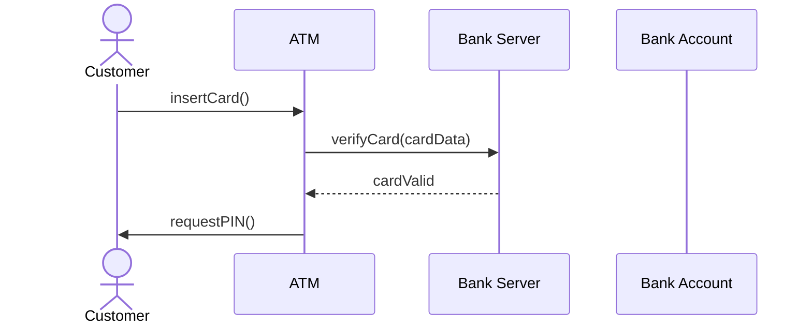

### 2.2. What a Sequence Diagram Does Not Show Well

A Sequence Diagram is not the best artifact for:

- static class structure;
- database schema;
- a complete state machine;
- complex data transformation details;
- every possible scenario in one crowded diagram;
- precise performance timing unless time constraints are added explicitly.

Use a Class Diagram for static structure, a State Machine for lifecycle behavior, and an Activity Diagram for workflow-oriented control flow.

---

## 3. Define the Scenario Before Drawing

A Sequence Diagram should model one purposeful interaction or a tightly bounded family of variants.

For the running example:

- **Scenario:** Withdraw cash from an ATM
- **Primary actor:** Customer
- **Starting condition:** The ATM is available and the customer has a bank card
- **Success outcome:** Cash is dispensed, the account is debited, and the card is returned
- **Important alternatives:** Invalid card, invalid PIN, and insufficient funds

A good diagram title is scenario-oriented:

- `Withdraw Cash`
- `Place Order`
- `Reset Password`
- `Open Graphic Document`

Avoid vague titles such as `ATM Flow` or `System Sequence` when a precise scenario name is available.

---

## 4. Participants

A participant is an element that takes part in the interaction.

A participant may represent:

- an external actor;
- a specific object;
- an instance of a class;
- a subsystem;
- a service;
- a database or external system, when it matters to the selected view.

### 4.1. ATM Example Participants

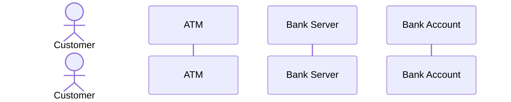

The participants are:

- `Customer`: an external actor;
- `ATM`: the machine or interaction boundary;
- `Bank Server`: a service coordinating validation and withdrawal processing;
- `Bank Account`: the account information used to check and debit funds.

### 4.2. Actor versus Internal Participant

An actor represents an external role interacting with the subject. Internal participants collaborate within the modeled system or solution boundary.

> The transcript calls the ATM, server, and account “objects.” This is acceptable for an introductory example, but a real diagram should label each lifeline according to the abstraction level being modeled. A server or account may represent an object, service, subsystem, or conceptual participant.

### 4.3. Participant Naming

Useful UML styles include:

```text
customer:Customer
atm:ATM
bankServer:BankServer
account:BankAccount
```

Interpretation:

- left of the colon: instance or role name;
- right of the colon: classifier or type.

If only the type matters, a diagram may show:

```text
:ATM
:BankServer
```

Be consistent across the diagram.

### 4.4. Left-to-Right Placement

A practical ordering is:

1. initiating actor on the left;
2. boundary or interface participant;
3. control or application service;
4. entity, repository, or external service participants.

This often produces readable diagrams, but left-to-right order is a layout choice, not temporal semantics.

---

## 5. Lifelines

A lifeline represents a participant's presence during the interaction.

It consists of:

- a participant head;
- a vertical dashed line extending downward.

Time progresses downward along the lifeline.

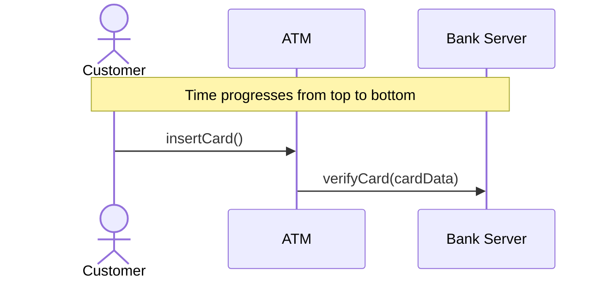

### 5.1. Lifeline Does Not Mean Continuous Execution

The dashed lifeline indicates that the participant exists or participates during that portion of the interaction. It does not mean the participant is continuously executing behavior.

Execution is shown separately using an execution specification, often called an activation bar.

---

## 6. Messages

Messages represent communication between lifelines.

A message should express intent clearly. Prefer operation-like verb phrases:

- `insertCard()`
- `verifyCard(cardData)`
- `requestPIN()`
- `verifyPIN(pin)`
- `checkAvailableFunds(amount)`
- `debit(amount)`
- `dispenseCash(amount)`

Avoid labels such as:

- `data`;
- `process`;
- `call method`;
- `do validation`.

### 6.1. Sequence Order

Messages higher on the page occur before messages lower on the page.

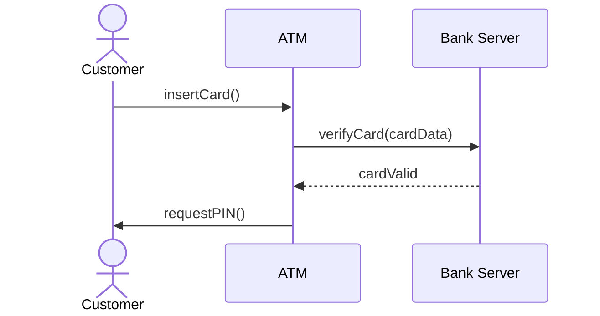

---

## 7. Synchronous Messages

A synchronous message represents a call in which the sender waits for the invoked behavior to complete before continuing that thread of execution.

In Mermaid, `->>` is used here to illustrate a call.

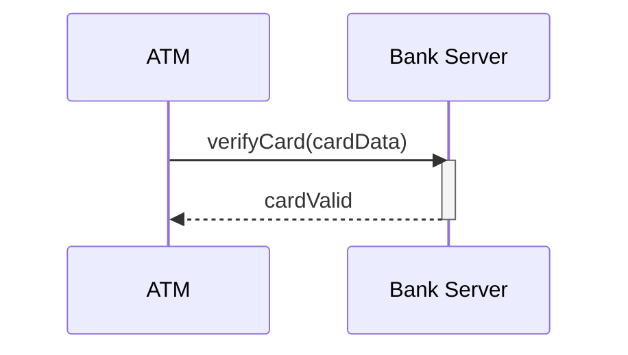

Typical examples:

- an object calling another object's operation;
- a service waiting for a database query;
- a controller waiting for application-service validation.

Do not assume that every solid arrow is synchronous merely because it is solid. UML distinguishes message sorts by arrowhead form; use your modeling tool's notation deliberately.

---

## 8. Reply Messages

A reply message represents return of control or returned information from an earlier call. It is commonly shown with a dashed line.

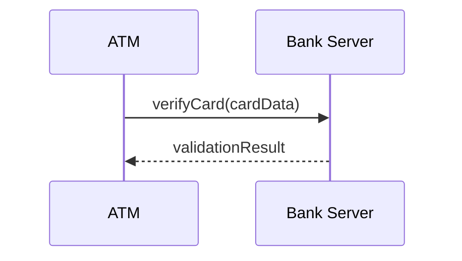

### 8.1. Replies Are Optional

UML does not require every synchronous call to have an explicit reply arrow. Show replies when they add useful information, such as:

- a returned value;
- an important status;
- an error result;
- completion that readers might otherwise misunderstand.

Omit low-value replies that only clutter the diagram.

### 8.2. User Input Is Not Automatically a Reply Message

The transcript treats `PIN entered` as a reply because the ATM requested a PIN. This is a helpful narrative shortcut but can be semantically misleading.

A human entering a PIN is usually modeled as a new message from the actor:

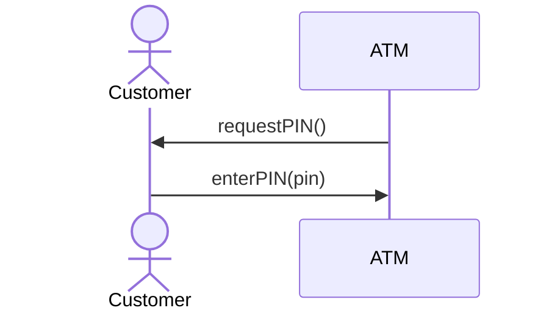

Use a dashed reply only when the semantics truly represent a response or returned value in the selected interaction model.

---

## 9. Asynchronous Messages

An asynchronous message allows the sender to continue without waiting for the receiver to finish.

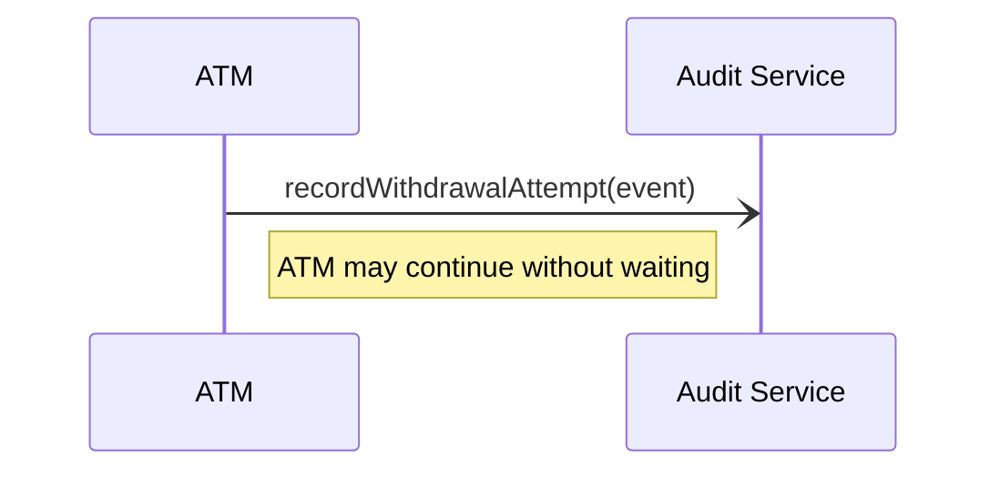

Typical examples:

- publishing an event;
- sending a message to a queue;
- starting a background task;
- fire-and-forget notification.

Do not use asynchronous notation merely because a network is involved. A remote HTTP call can still be synchronous from the caller's perspective.

---

## 10. Self Messages

A self message shows a participant invoking its own behavior.

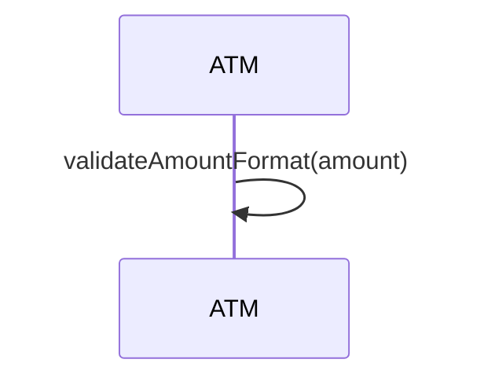

Use self messages when the internal step is relevant to the design discussion. Avoid exposing every private helper call.

---

## 11. Create and Delete Messages

A create message indicates that a participant begins to exist during the interaction.

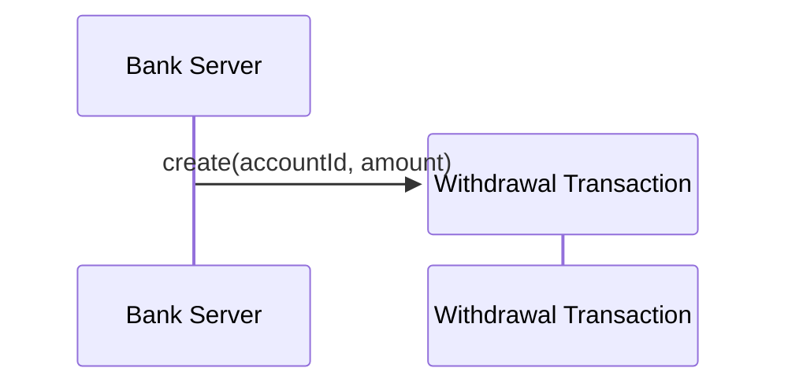

A delete message indicates destruction of an instance.

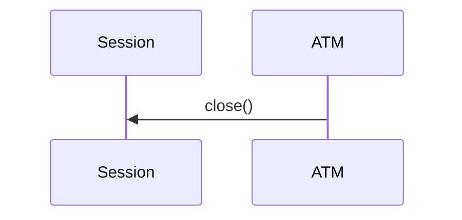

Only show creation and destruction when lifecycle is meaningful to the scenario.

---

## 12. Execution Specifications

An execution specification is the thin rectangle placed on a lifeline while that participant is executing behavior. It is often called an activation bar.

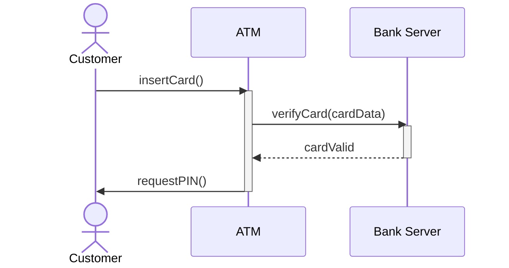

### 12.1. Interpretation

An execution specification shows a period during which a participant is performing an action, directly or through nested calls.

It does not simply mean “the object is alive.”

### 12.2. Actors May Have Executions

The transcript suggests actors do not need activation boxes because they are external. That is a presentational simplification, not a UML prohibition.

Actors may have execution specifications when their active participation matters. In many business-facing diagrams, omitting actor activations improves readability.

### 12.3. Avoid Overstretching Activations

Do not draw one activation bar around every message on a lifeline automatically. Align executions with actual control and processing semantics.

---

## 13. Guards

A guard is a Boolean condition written in square brackets.

Examples:

```text
[card valid]
[PIN invalid]
[availableBalance >= amount]
[retryCount < 3]
```

Guards should be:

- mutually understandable;
- testable;
- concise;
- derived from scenario requirements.

Avoid vague guards such as `[okay]`, `[normal]`, or `[error]` when a precise condition is available.

---

## 14. Combined Fragments

Combined fragments structure conditional, optional, repeated, parallel, or referenced behavior.

The operator appears in the fragment header.

Common operators include:

- `alt`: alternatives;
- `opt`: optional behavior;
- `loop`: repetition;
- `par`: parallel behavior;
- `break`: abort the enclosing interaction;
- `critical`: atomic region;
- `ref`: reference another interaction.

---

## 15. Alternative Fragment (`alt`)

An `alt` fragment represents mutually exclusive alternatives. Each operand has a guard.

### 15.1. Card Validation

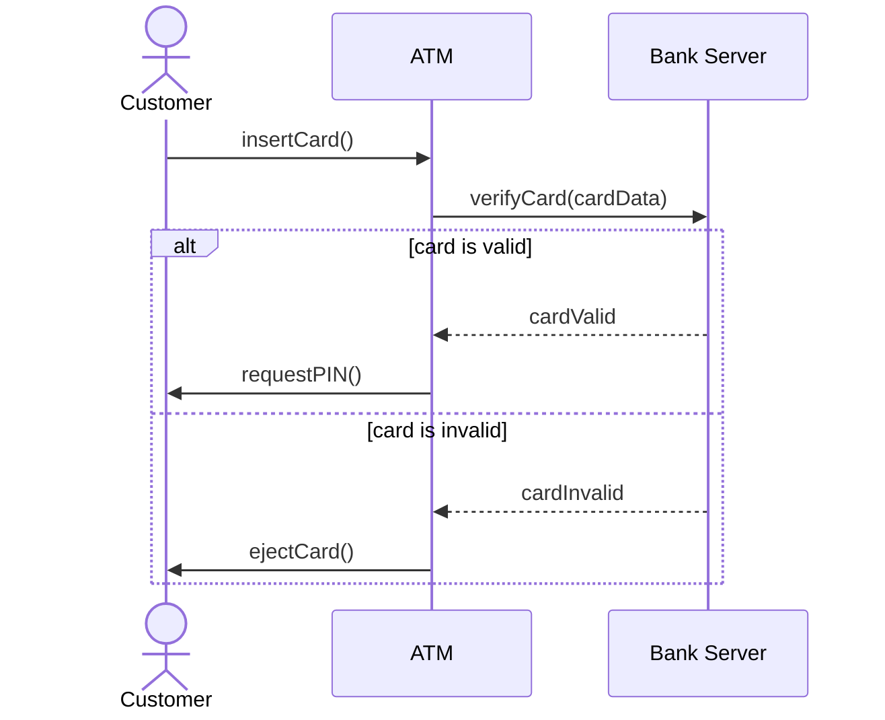

### 15.2. Guard Form

In a UML tool, prefer explicit guard notation:

```text
[card valid]
[else]
```

or:

```text
[card valid]
[card invalid]
```

The operands should not overlap unless the model intentionally permits nondeterministic choice.

---

## 16. Optional Fragment (`opt`)

An `opt` fragment contains behavior that occurs only when its guard is true.

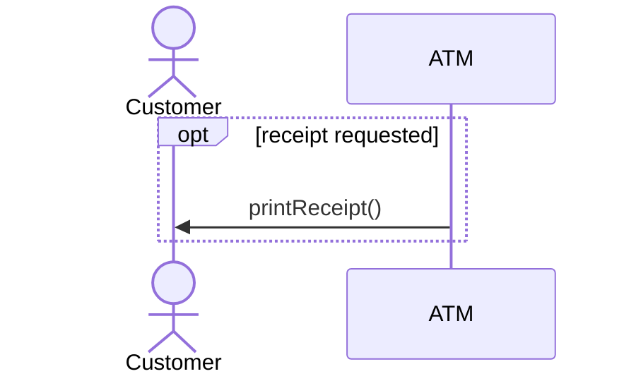

Use `opt` when there is one conditional branch and no meaningful alternative behavior.

---

## 17. Loop Fragment (`loop`)

A `loop` fragment represents repeated behavior.

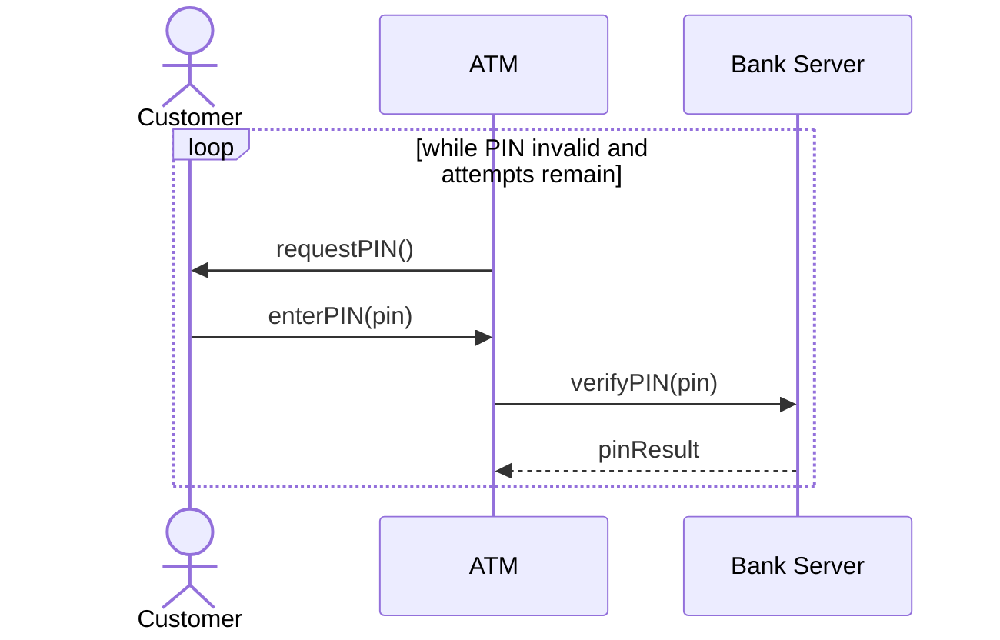

A useful loop should state its condition or bounds:

- `[attempts < 3]`;
- `[for each item]`;
- `[while payment pending]`.

---

## 18. Parallel Fragment (`par`)

A `par` fragment represents operands that may proceed concurrently.

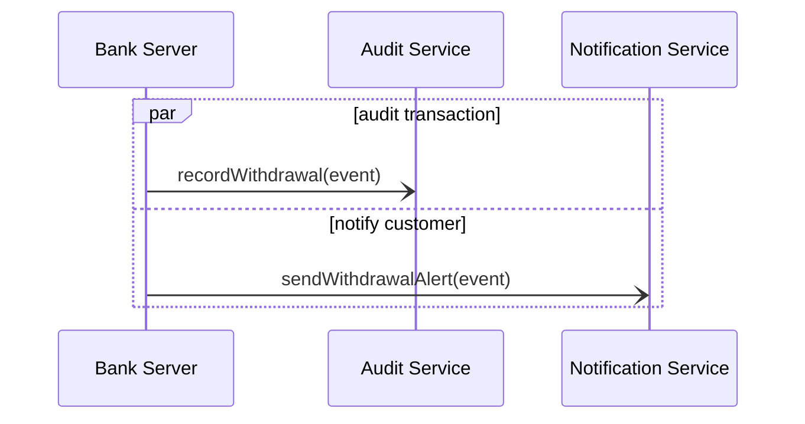

Use `par` only when concurrency matters. Do not use it as a visual grouping box.

---

## 19. Build the ATM Withdrawal Diagram

### Step 1: Define the Scenario

Scenario: **Withdraw Cash**

Success outcome:

- card and PIN are valid;
- sufficient funds exist;
- account is debited;
- cash is dispensed;
- card is returned.

Alternatives:

- invalid card;
- invalid PIN;
- insufficient funds.

### Step 2: Select Participants


### Step 3: Validate the Card


### Step 4: Validate the PIN

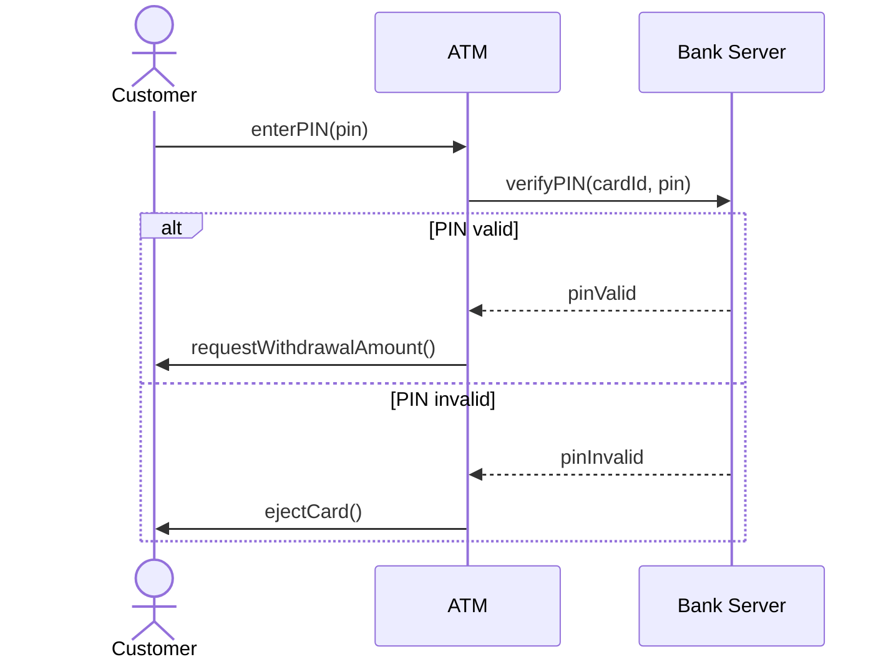

### Step 5: Process the Withdrawal

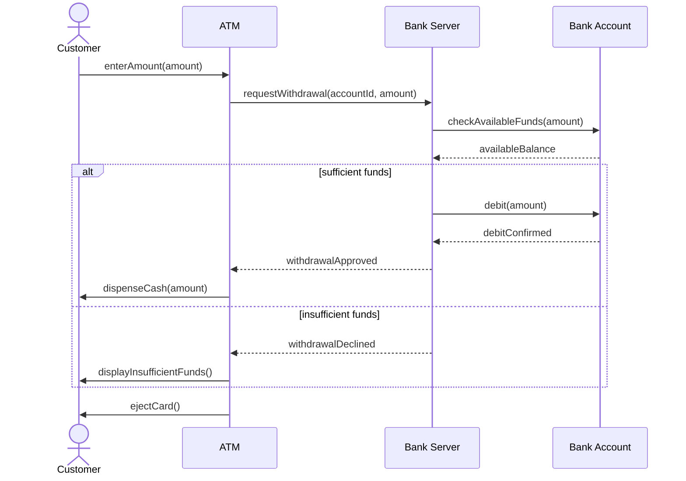

---

## 20. Complete ATM Cash Withdrawal Diagram

```mermaid
sequenceDiagram
    actor Customer
    participant ATM
    participant BankServer as Bank Server
    participant Account as Bank Account

    Customer->>ATM: insertCard()
    activate ATM
    ATM->>BankServer: verifyCard(cardData)
    activate BankServer

    alt card valid
        BankServer-->>ATM: cardValid
        deactivate BankServer
        ATM->>Customer: requestPIN()
        Customer->>ATM: enterPIN(pin)
        ATM->>BankServer: verifyPIN(cardId, pin)
        activate BankServer

        alt PIN valid
            BankServer-->>ATM: pinValid
            deactivate BankServer
            ATM->>Customer: requestWithdrawalAmount()
            Customer->>ATM: enterAmount(amount)
            ATM->>BankServer: requestWithdrawal(accountId, amount)
            activate BankServer
            BankServer->>Account: checkAvailableFunds(amount)
            activate Account
            Account-->>BankServer: availableBalance

            alt sufficient funds
                BankServer->>Account: debit(amount)
                Account-->>BankServer: debitConfirmed
                deactivate Account
                BankServer-->>ATM: withdrawalApproved
                deactivate BankServer
                ATM->>Customer: dispenseCash(amount)
            else insufficient funds
                deactivate Account
                BankServer-->>ATM: withdrawalDeclined
                deactivate BankServer
                ATM->>Customer: displayInsufficientFunds()
            end

            ATM->>Customer: ejectCard()
        else PIN invalid
            BankServer-->>ATM: pinInvalid
            deactivate BankServer
            ATM->>Customer: ejectCard()
        end
    else card invalid
        BankServer-->>ATM: cardInvalid
        deactivate BankServer
        ATM->>Customer: ejectCard()
    end

    deactivate ATM
```

### 20.1. Reading the Diagram

1. Customer inserts a card.
2. ATM asks Bank Server to validate it.
3. Invalid cards are rejected.
4. A valid card leads to PIN entry and validation.
5. An invalid PIN ends the scenario in this simplified version.
6. A valid PIN leads to amount entry.
7. Bank Server checks the Bank Account.
8. Sufficient funds lead to debit confirmation and cash dispensing.
9. Insufficient funds lead to a declined withdrawal.
10. The ATM returns the card before the interaction ends.

### 20.2. Deliberate Simplifications

A production ATM interaction may also include:

- three PIN attempts;
- retained cards;
- withdrawal limits;
- ATM cash availability;
- account locks;
- fees;
- audit logging;
- timeout and cancellation;
- partial hardware failure;
- compensation if debit succeeds but cash dispensing fails.

Do not force all variants into one diagram. Create separate scenario diagrams when alternatives become difficult to read.

---

## 21. System Sequence Diagram versus Design Sequence Diagram

### 21.1. System Sequence Diagram

A System Sequence Diagram treats the entire system as one black-box participant.

```mermaid
sequenceDiagram
    actor Customer
    participant ATMSystem as ATM System

    Customer->>ATMSystem: insertCard(cardData)
    ATMSystem->>Customer: requestPIN()
    Customer->>ATMSystem: enterPIN(pin)
    ATMSystem->>Customer: requestWithdrawalAmount()
    Customer->>ATMSystem: withdraw(amount)
    ATMSystem-->>Customer: cashAndCard
```

Use it for:

- requirements analysis;
- defining system events;
- clarifying actor-system interaction;
- avoiding premature internal design.

### 21.2. Design Sequence Diagram

A design-level diagram opens the black box and shows collaborating internal participants.

```mermaid
sequenceDiagram
    actor Customer
    participant ATM
    participant WithdrawalController
    participant AccountRepository
    participant CashDispenser

    Customer->>ATM: enterAmount(amount)
    ATM->>WithdrawalController: withdraw(accountId, amount)
    WithdrawalController->>AccountRepository: find(accountId)
    AccountRepository-->>WithdrawalController: account
    WithdrawalController->>WithdrawalController: authorize(amount)
    WithdrawalController->>CashDispenser: dispense(amount)
```

Use it for:

- responsibility assignment;
- interface design;
- service collaboration;
- implementation planning.

Do not mix black-box and detailed internal views accidentally.

---

## 22. Boundary, Control, and Entity Heuristic

A design sequence may classify responsibilities using stereotypes:

- `<<boundary>>`: interaction with users or external systems;
- `<<control>>`: scenario coordination;
- `<<entity>>`: domain information and behavior.

```mermaid
sequenceDiagram
    actor Customer
    participant ATM as <<boundary>> ATM
    participant Controller as <<control>> WithdrawalController
    participant Account as <<entity>> Account

    Customer->>ATM: enterAmount(amount)
    ATM->>Controller: withdraw(accountId, amount)
    Controller->>Account: canWithdraw(amount)
    Account-->>Controller: decision
```

This is a heuristic, not a requirement. Use it only when it improves responsibility reasoning.

---

## 23. Common Modeling Mistakes

### 23.1. Modeling an Entire System in One Diagram

A Sequence Diagram should focus on one scenario. Split large interactions by use case, variant, service boundary, or referenced interaction.

### 23.2. Using Classes When the View Requires Instances

A lifeline usually represents an interacting instance or role. Label it consistently, such as `atm:ATM`, instead of ambiguously mixing class names and object names.

### 23.3. Treating Every Actor Response as a Dashed Reply

User input is often a new message, not a UML return message.

### 23.4. Showing Every Reply

Reply messages are optional. Include them only when the returned value or completion is useful.

### 23.5. Using `alt` without Guards

Each operand should state the condition under which it executes.

### 23.6. Using `alt` for One Optional Branch

Use `opt` when there is only one guarded optional behavior.

### 23.7. Activating a Lifeline for Its Entire Existence

A lifeline represents existence; an execution specification represents active behavior.

### 23.8. Treating Left-to-Right Order as Time

Time moves downward. Horizontal order is for readability.

### 23.9. Mixing Abstraction Levels

Do not place a business actor, a whole subsystem, a source-code helper, and a database table in the same diagram unless the selected design view explicitly requires that mix.

### 23.10. Omitting Failure and Cancellation Paths

A happy path alone may hide critical requirements. Add important alternatives or create separate diagrams.

### 23.11. Messages without Clear Ownership

A message should identify the participant responsible for receiving and performing the requested behavior.

### 23.12. Modeling Control Logic as Notes Only

Use guards and combined fragments for behavior that affects interaction order. Notes should explain, not replace, semantics.

---

## 24. Review Checklist

### Scenario and Scope

- [ ] The diagram has one clear scenario title.
- [ ] Preconditions and intended outcome are understood.
- [ ] The abstraction level is consistent.
- [ ] Important alternatives are modeled or referenced.

### Participants

- [ ] Every participant is necessary to the scenario.
- [ ] Actors are external roles.
- [ ] Lifeline labels consistently show role, instance, type, or subsystem.
- [ ] Participants are arranged for readability.

### Messages

- [ ] Messages are ordered from top to bottom.
- [ ] Labels use clear verb phrases or operation signatures.
- [ ] Synchronous and asynchronous messages are distinguished intentionally.
- [ ] Reply messages are used only when valuable.
- [ ] Self messages expose only relevant internal behavior.

### Fragments and Guards

- [ ] `alt` operands are mutually exclusive or intentionally nondeterministic.
- [ ] `opt` is used for one optional branch.
- [ ] `loop` states its condition or bounds.
- [ ] `par` represents genuine concurrency.
- [ ] Guards are explicit and testable.

### Execution and Lifecycle

- [ ] Execution specifications align with actual behavior.
- [ ] Create and delete messages are shown when lifecycle matters.
- [ ] Lifeline existence is not confused with execution.

### Readability

- [ ] The diagram is readable at presentation size.
- [ ] Message lines cross as little as possible.
- [ ] The diagram is not overloaded with implementation detail.
- [ ] Notes supplement rather than replace notation.

---

## 25. Practice Exercises

### Exercise 1: Identify the Element

Classify each item:

1. Customer stick figure
2. Vertical dashed line
3. `verifyPIN(pin)` arrow
4. Thin rectangle on the Bank Server lifeline
5. Box labeled `alt`
6. `[sufficient funds]`

Choose from:

- Actor
- Lifeline
- Message
- Execution specification
- Combined fragment
- Guard

### Exercise 2: Choose the Message Type

Select synchronous, asynchronous, reply, self, create, or delete:

1. ATM waits for Bank Server to validate a card.
2. Bank Server publishes an audit event and continues.
3. Bank Server returns `cardValid`.
4. ATM validates amount formatting internally.
5. Bank Server creates a Withdrawal Transaction.
6. ATM closes a temporary session.

### Exercise 3: Select the Fragment

Choose `alt`, `opt`, `loop`, or `par`:

1. Send a receipt only when requested.
2. Retry PIN entry while attempts remain.
3. Choose between approved and declined withdrawal.
4. Record an audit event and send a notification concurrently.

### Exercise 4: Correct the Diagram Logic

Find the issue in each statement:

1. A reply message is used for every user input.
2. The diagram places later messages farther to the right rather than lower.
3. One activation bar covers the participant's whole lifeline.
4. An `alt` fragment has no guards.
5. A diagram shows Customer, ATM System, WithdrawalController, a private helper function, and a database table without explaining its abstraction level.

### Exercise 5: Build a Login Sequence

Participants:

- User
- Web App
- Authentication Service
- User Repository

Requirements:

- User submits username and password.
- Web App asks Authentication Service to authenticate.
- Authentication Service loads the user.
- If credentials are valid, create a session and return success.
- Otherwise, return failure.
- After three failed attempts, lock the account.

Your diagram should include:

- clear lifelines;
- operation-like messages;
- at least one `alt` fragment;
- a `loop` or explicit retry structure;
- relevant execution specifications.

---

## 26. Suggested Answers

### Exercise 1

1. Actor
2. Lifeline
3. Message
4. Execution specification
5. Combined fragment
6. Guard

### Exercise 2

1. Synchronous
2. Asynchronous
3. Reply
4. Self
5. Create
6. Delete

### Exercise 3

1. `opt`
2. `loop`
3. `alt`
4. `par`

### Exercise 4

1. User input is normally a new message unless the selected semantics genuinely represent a return.
2. Time progresses downward, not left to right.
3. Lifeline existence and active execution have been confused.
4. The choice conditions are missing.
5. The diagram mixes black-box, design, code, and persistence levels without a controlled view.

### Exercise 5: One Possible Model

```mermaid
sequenceDiagram
    actor User
    participant WebApp as Web App
    participant Auth as Authentication Service
    participant Repo as User Repository
    participant Session as Session Service

    loop while attempts remain
        User->>WebApp: submitCredentials(username, password)
        WebApp->>Auth: authenticate(username, password)
        activate Auth
        Auth->>Repo: findByUsername(username)
        Repo-->>Auth: userRecord

        alt credentials valid
            Auth->>Session: createSession(userId)
            Session-->>Auth: sessionToken
            Auth-->>WebApp: authenticationSucceeded(sessionToken)
            WebApp-->>User: showAuthenticatedHome()
        else credentials invalid and attempts remain
            Auth-->>WebApp: authenticationFailed()
            WebApp-->>User: showLoginError()
        else third failed attempt
            Auth->>Repo: lockAccount(userId)
            Auth-->>WebApp: accountLocked()
            WebApp-->>User: showAccountLocked()
        end
        deactivate Auth
    end
```

A production design should define where the attempt count is stored and how concurrency, reset windows, and distributed login attempts are handled.

---

## 27. Teaching Guide

### Recommended Duration

| Activity                      |  Suggested time |
| ----------------------------- | --------------: |
| Purpose and scenario scope    |      10 minutes |
| Participants and lifelines    |      15 minutes |
| Message types                 |      30 minutes |
| Execution specifications      |      15 minutes |
| Guards and combined fragments |      30 minutes |
| Build the ATM diagram         |      30 minutes |
| System versus design sequence |      15 minutes |
| Exercises and review          |      30 minutes |
| **Total**                     | **175 minutes** |

### Teaching Sequence

1. Begin with one simple actor-to-system interaction.
2. Establish that time proceeds downward.
3. Add internal participants only after the scenario is clear.
4. Teach synchronous calls and replies before other message types.
5. Introduce executions as periods of behavior, not participant existence.
6. Add `alt` for the first meaningful failure path.
7. Add `opt`, `loop`, and `par` only after guards are understood.
8. Compare a black-box System Sequence Diagram with a design-level diagram.
9. Finish with a learner-built login or checkout scenario.

### Instructor Prompts

- “What single scenario does this diagram realize?”
- “Which participant owns this responsibility?”
- “Does the sender wait for completion?”
- “Is this dashed arrow really a returned result?”
- “What exact Boolean condition selects this operand?”
- “Does this behavior repeat, remain optional, or run in parallel?”
- “Is the lifeline alive, or actively executing?”
- “Are we modeling the system as a black box or showing internal design?”
- “Would a separate diagram make this alternative clearer?”

---

## 28. Key Takeaways

1. A Sequence Diagram models an ordered interaction for a scenario.
2. Time progresses from top to bottom.
3. Lifelines represent participants, not continuous execution.
4. Execution specifications show when behavior is executing.
5. Message notation should distinguish synchronous, asynchronous, reply, self, create, and delete semantics.
6. Reply messages are optional and should add useful information.
7. User input is not automatically a reply message.
8. Guards express testable conditions.
9. `alt`, `opt`, `loop`, and `par` structure different control semantics.
10. System Sequence Diagrams and design Sequence Diagrams serve different abstraction levels.
11. One focused scenario is usually clearer than one enormous interaction diagram.
12. Every message should reinforce responsibility assignment.

---

## 29. Glossary

| Term                    | Meaning                                                                  |
| ----------------------- | ------------------------------------------------------------------------ |
| Actor                   | An external role participating in the interaction                        |
| Asynchronous message    | A message whose sender does not wait for completion                      |
| Combined fragment       | A frame expressing interaction control such as alternatives or loops     |
| Create message          | A message that begins a participant's lifetime                           |
| Delete message          | A message that ends an instance's lifetime                               |
| Execution specification | A period during which a participant performs behavior                    |
| Guard                   | A Boolean condition selecting a fragment operand                         |
| Lifeline                | A participant's presence over time in an interaction                     |
| Message                 | Communication between lifelines                                          |
| Participant             | An actor, object, role, service, subsystem, or other interaction element |
| Reply message           | A return of control or information from an earlier call                  |
| Self message            | A participant invoking its own behavior                                  |
| Sequence Diagram        | A UML interaction diagram emphasizing message order over time            |
| Synchronous message     | A call whose sender waits for completion                                 |
| System Sequence Diagram | A black-box interaction between external actors and the system           |

---

## Source and Adaptation Note

This handbook was adapted from the UML Sequence Diagram tutorial transcript supplied by the user. The spoken material was reorganized into a teaching structure and supplemented with Mermaid diagrams, message taxonomy, combined fragments, semantic cautions, a modeling workflow, review criteria, exercises, suggested answers, and instructor guidance.

The ATM cash-withdrawal scenario remains the instructional backbone. Several introductory shortcuts were refined to avoid teaching misleading semantics, particularly around reply messages, actor activations, participant labeling, synchronous versus asynchronous communication, and the distinction between a System Sequence Diagram and a design-level Sequence Diagram.
