# UML Use Case Diagram Handbook

> **Purpose:** A practical foundation for learning and teaching UML Use Case Diagrams through one consistent **Banking App** example.
>
> **Scope:** System boundary, actors, use cases, associations, `<<include>>`, `<<extend>>`, generalization, extension points, modeling workflow, review checklist, exercises, and teaching guidance.

---

## 1. Learning Objectives

After completing this handbook, learners should be able to:

1. Explain the purpose and limits of a Use Case Diagram.
2. Define a system boundary and keep the model within scope.
3. Identify actors as external roles rather than named individuals.
4. Name use cases as meaningful actor goals.
5. Model associations, `<<include>>`, `<<extend>>`, and generalization correctly.
6. Explain the direction of each relationship arrow.
7. Build and review a small Use Case Diagram for a Banking App.
8. Recognize common modeling mistakes and move excessive detail to a Use Case Specification.

---

## 2. What Is a Use Case Diagram?

A Use Case Diagram is a UML behavioral diagram that presents a high-level view of:

- the system being considered;
- the external roles or systems that interact with it;
- the goals those actors achieve through it;
- the main relationships among actors and use cases.

It is especially useful when an idea seems clear to its creator but is difficult to explain to other people. The diagram provides a simple visual map of the system's external behavior.

A Use Case Diagram answers four core questions:

1. **System:** What system are we modeling?
2. **Actors:** Who or what interacts with it?
3. **Use cases:** What goals do those actors achieve?
4. **Relationships:** How are the actors and use cases connected?

### 2.1. What It Does Not Show

A Use Case Diagram does not normally describe:

- detailed execution order;
- algorithms or internal implementation;
- classes and object structures;
- database design;
- complete user-interface navigation;
- every alternative and error flow.

Those details belong in artifacts such as a **Use Case Specification**, Activity Diagram, Sequence Diagram, Class Diagram, or UI prototype.

### 2.2. Concept Map


> **Mermaid note:** Mermaid does not currently provide native UML Use Case Diagram syntax. Each diagram therefore uses a flowchart while preserving all four teaching elements: actors, a named system boundary, use cases, and relationships. Actors are shown with a standing-person symbol (`🧍`) and a role name. In a UML modeling tool, replace that symbol with the standard stick-figure actor and use native ellipse, dependency, and generalization notation.

---

## 3. The Four Core Elements

Use Case Diagrams in this handbook are organized around four elements:

1. System
2. Actor
3. Use Case
4. Relationship

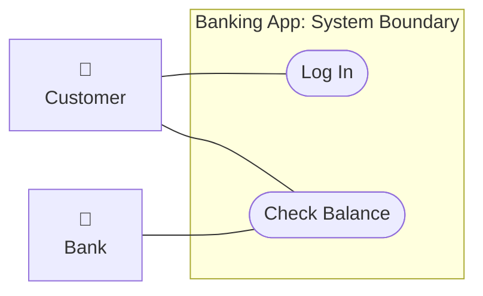

---

## 3.1. System

### 3.1.1. Definition

The **system** is the subject being developed or analyzed. It may be:

- an application;
- a website;
- a software component;
- a business process;
- a subsystem;
- a complete software product.

The running example uses a system named **Banking App**.

### 3.1.2. System Boundary

The system is represented by a rectangle labeled with the system name. This rectangle defines the **system boundary**.

- Use cases are placed **inside** the boundary because they describe behavior provided by the system.
- Actors are placed **outside** the boundary because they represent external roles, devices, organizations, or systems.

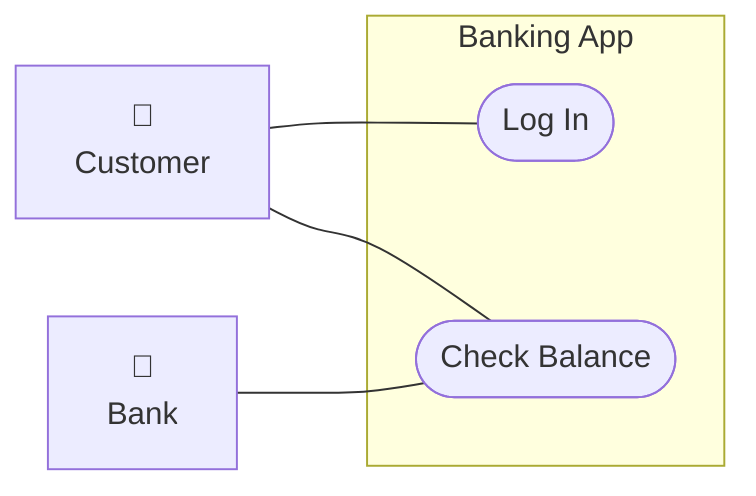

### 3.1.3. Scope Check

Before adding an element, ask:

> Is this behavior the responsibility of the Banking App, or does it belong to the external environment?

If the responsibility belongs to the Banking App, it may appear as a use case inside the boundary. If it is an external role or system interacting with the app, it may be an actor.

---

## 3.2. Actor

### 3.2.1. Definition

An **actor** is an external role that interacts with the system to achieve a goal or to support the system in fulfilling a goal.

An actor can be:

- a person;
- an organization;
- another system;
- an external device.

An actor is not necessarily human.

### 3.2.2. Actors in the Banking App Example

- **Customer:** Uses the application to log in, check a balance, transfer funds, and make payments.
- **Bank:** Supplies account information and supports or executes financial transactions.

### 3.2.3. Actor Means Role, Not Individual

Actors should be named as roles or categories, not as specific people or organizations.

| Avoid                 | Prefer           |
| --------------------- | ---------------- |
| John                  | Customer         |
| Chase Bank            | Bank             |
| Alice from Accounting | Accountant       |
| Device SN-0841        | Payment Terminal |

One person may play several actor roles, and several people may play the same actor role.

### 3.2.4. Primary and Supporting Actors

A **primary actor** initiates interaction with the system to achieve a goal. In the example, **Customer** is the primary actor.

A **supporting actor** provides a service or information required by the system. In the example, **Bank** supports balance retrieval and transaction processing.

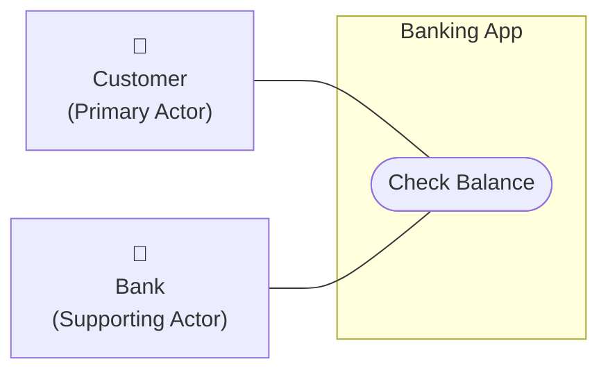

Placing primary actors on the left and supporting actors on the right can improve readability, but it is a presentation convention rather than a mandatory UML semantic rule.

### 3.2.5. Actor Identification Checklist

Ask:

- Who initiates a goal through the system?
- Who receives value from the system?
- Which external systems send or receive information?
- Which external devices interact with the system?
- Who administers, operates, or supports the system?

Do not create an actor merely because something is mentioned in the business domain. It must have a meaningful interaction across the system boundary.

---

## 3.3. Use Case

### 3.3.1. Definition

A **use case** represents a goal or service that the system provides to an actor. In a standard UML diagram, it is shown as an ellipse inside the system boundary.

### 3.3.2. Banking App Use Cases

The main use cases are:

- **Log In**
- **Check Balance**
- **Transfer Funds**
- **Make Payment**


### 3.3.3. Naming Use Cases

A good use case name should:

1. start with a verb;
2. express a meaningful goal or result;
3. be specific enough to understand;
4. use consistent business vocabulary.

| Weak name      | Problem                 | Better name    |
| -------------- | ----------------------- | -------------- |
| Transfer       | Too vague               | Transfer Funds |
| Balance        | Noun only               | Check Balance  |
| Payment Screen | Describes UI            | Make Payment   |
| User Data      | Does not express a goal | Update Profile |

### 3.3.4. Choose the Right Goal Level

Use cases should represent goals that provide recognizable value to an actor.

- **Transfer Funds** is a customer goal.
- **Verify Sufficient Funds** is supporting behavior that may be extracted for reuse.
- Reading an internal variable is an implementation detail, not an actor goal.

Not every internal step deserves a separate use case.

### 3.3.5. Diagram Position Is Not Execution Order

You may arrange use cases in a logical order to improve readability. However, vertical or horizontal position does not define execution sequence in UML.

If logging in is a precondition for another use case, record that fact in the Use Case Specification. Do not use diagram position as a substitute for explicit semantics.

---

## 3.4. Relationships

This handbook covers:

1. Association
2. `<<include>>`
3. `<<extend>>`
4. Generalization

---

### 3.4.1. Association

An **association** represents communication or participation between an actor and a use case. It is normally drawn as a solid line without an arrow.

In the Banking App:

- Customer is associated with Log In.
- Customer is associated with Check Balance.
- Customer is associated with Transfer Funds.
- Customer is associated with Make Payment.
- Bank is associated with Check Balance.
- Bank is associated with Transfer Funds.
- Bank is associated with Make Payment.

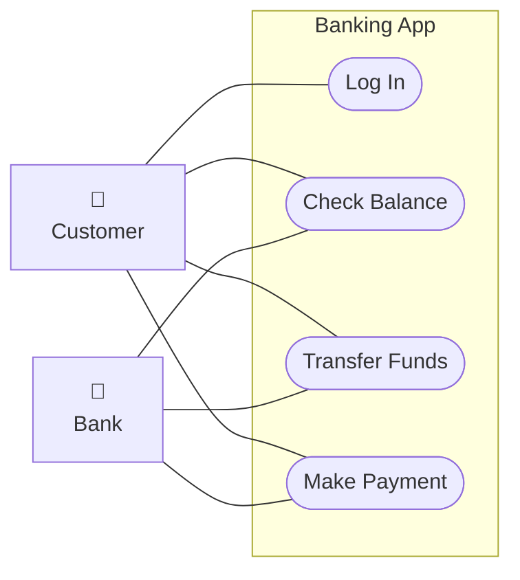

The Bank is not associated with Log In if authentication is handled entirely inside the Banking App and the Bank does not participate in it.

For every association, ask:

> Does this actor actually communicate with or participate in this use case?

Do not connect every actor to every use case merely because they are generally related to the system.

---

### 3.4.2. `<<include>>`

#### Meaning

`<<include>>` means that a base use case incorporates the behavior of an included use case at a defined point.

It is commonly used to:

- separate reusable behavior;
- avoid repeating the same behavior in several use cases;
- expose mandatory shared behavior.

#### Direction

The dependency arrow points:

> **Base use case → Included use case**

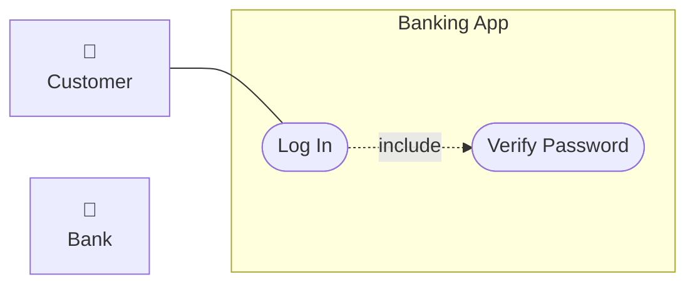

#### Banking App Examples

- Log In `<<include>>` Verify Password.
- Transfer Funds `<<include>>` Verify Sufficient Funds.
- Make Payment `<<include>>` Verify Sufficient Funds.

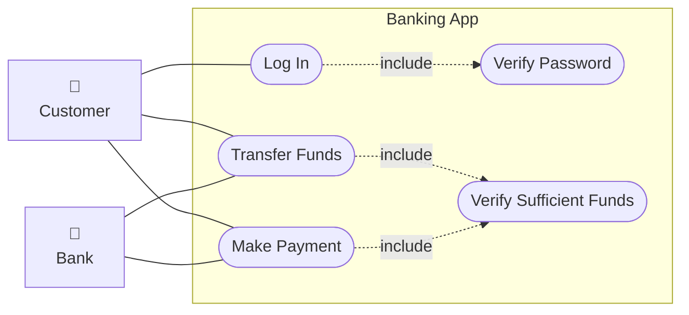

The shared use case **Verify Sufficient Funds** does not need to be duplicated. Several base use cases may include the same reusable behavior.

> **Memory aid:** The arrow points to the behavior being included.

---

### 3.4.3. `<<extend>>`

#### Meaning

`<<extend>>` means that additional behavior may be inserted into a base use case when a specified condition is satisfied.

The base use case must remain meaningful without the extending use case.

#### Direction

The dependency arrow points:

> **Extending use case → Base use case**

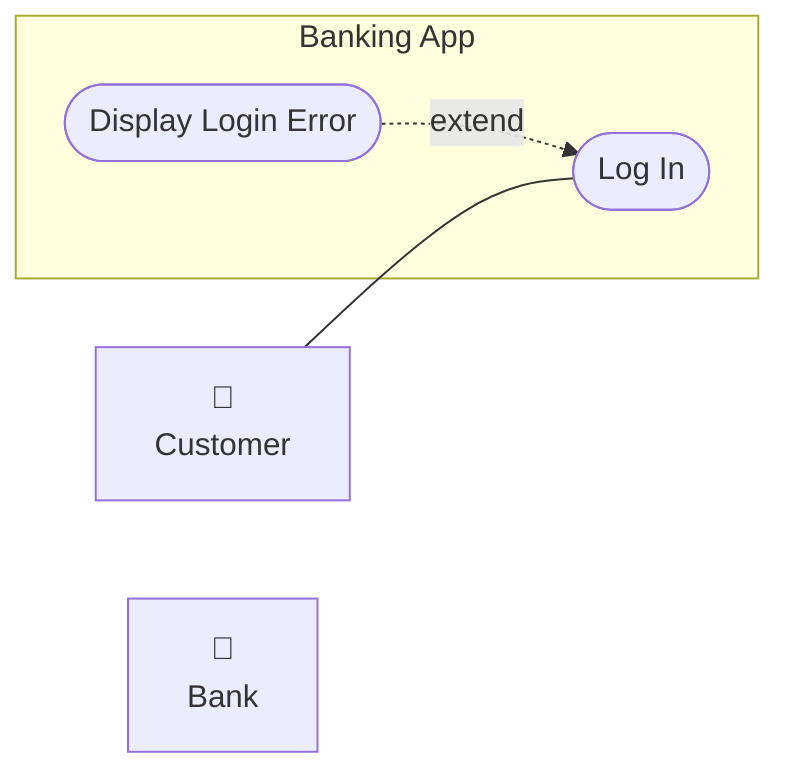

#### Banking App Example

- Display Login Error `<<extend>>` Log In.
- Condition: The credentials or password are invalid.

The error is not displayed during every login attempt. It extends Log In only when the error condition occurs.

> **Memory aid:** The arrow points to the use case being extended.

---

### 3.4.4. Comparing `<<include>>` and `<<extend>>`

| Criterion       | `<<include>>`                      | `<<extend>>`                        |
| --------------- | ---------------------------------- | ----------------------------------- |
| Main purpose    | Reuse mandatory or shared behavior | Add conditional behavior            |
| Base use case   | Incorporates the included behavior | Is meaningful without the extension |
| Arrow direction | Base → Included                    | Extending → Base                    |
| Banking example | Log In → Verify Password           | Display Login Error → Log In        |


Do not rely only on the shortcut “include always happens, extend sometimes happens.” Also ask:

- Are we extracting required or shared behavior?
- Or are we adding optional or conditional behavior to an already meaningful base use case?

---

### 3.4.5. Generalization

#### Meaning

**Generalization** relates a general element to one or more specialized elements. A specialized element inherits the relevant behavior and relationships of the general element and may add its own characteristics.

The hollow triangle points toward the **general** element.

#### Use Case Generalization

- General use case: Make Payment
- Specialized use cases:
  - Pay from Checking
  - Pay from Savings

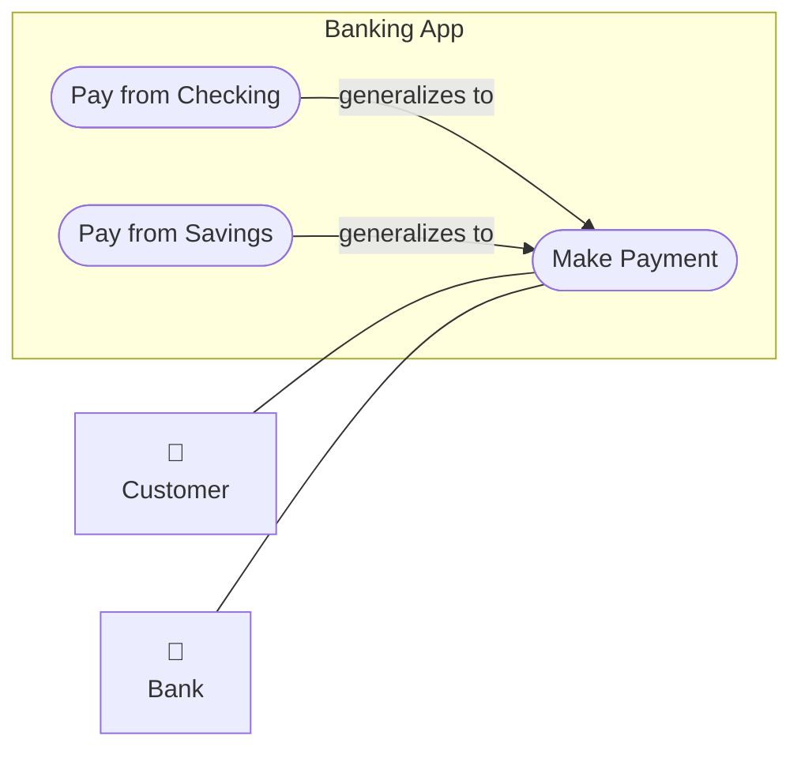

#### Actor Generalization

- General actor: Customer
- Specialized actors:
  - New Customer
  - Returning Customer

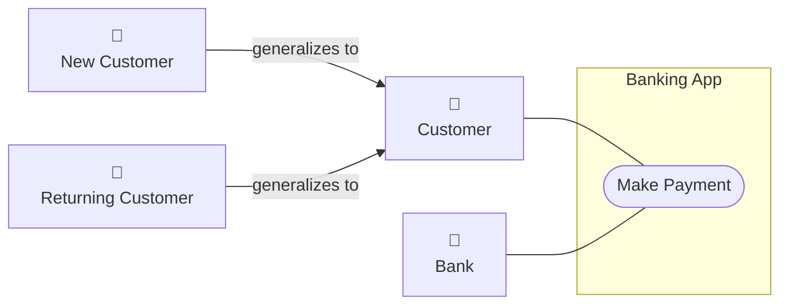

Use generalization only when the specialized element truly is a kind of the general element and can validly inherit its relationships.

> In a UML tool, replace the labeled Mermaid arrows with solid generalization lines and hollow triangle arrowheads.

---

### 3.4.6. Extension Points

An **extension point** is a named location in a base use case where extending behavior may be inserted.

Example base use case: **Set Up Profile**

Possible extension points:

- profile help;
- privacy information.

Possible extending use cases:

- Go to Profile Help;
- Show Privacy Info.

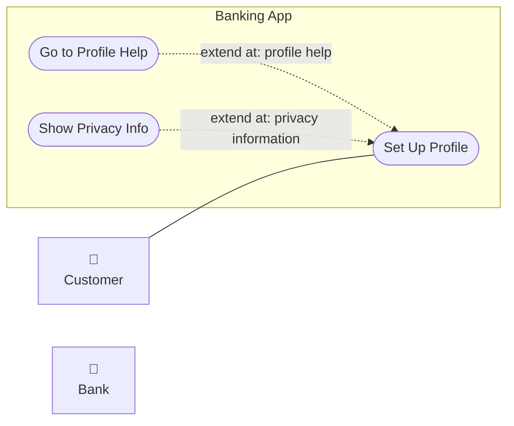

Extension points are useful when the insertion location matters. Do not add them if they increase complexity without improving understanding.

---

## 4. Building the Banking App Diagram

### Step 1: Define the Scope

System name: **Banking App**

Draw and label the system boundary before adding details.

### Step 2: Identify Actors

- Primary actor: Customer
- Supporting actor: Bank

Place both outside the system boundary.

### Step 3: Identify Actor Goals

Customer goals:

- Log In
- Check Balance
- Transfer Funds
- Make Payment

Place these use cases inside the Banking App.

### Step 4: Add Associations

Connect Customer to all four main use cases.

Connect Bank to:

- Check Balance
- Transfer Funds
- Make Payment

Do not connect Bank to Log In unless the Bank actually participates in authentication.

### Step 5: Add Shared Required Behavior

Add:

- Verify Password
- Verify Sufficient Funds

Then model:

- Log In `<<include>>` Verify Password
- Transfer Funds `<<include>>` Verify Sufficient Funds
- Make Payment `<<include>>` Verify Sufficient Funds

### Step 6: Add Conditional Behavior

Add Display Login Error and model:

- Display Login Error `<<extend>>` Log In
- Condition: Password is incorrect.

### Step 7: Add Generalization When It Adds Meaning

Add:

- Pay from Checking
- Pay from Savings

Model both as specializations of Make Payment.

### Step 8: Review Simplicity

Ask:

- Are too many lines crossing?
- Is any use case merely an implementation detail?
- Does every actor really interact with the system?
- Are `<<include>>` and `<<extend>>` arrows correctly directed?
- Can a reader understand the system goals without a long explanation?

---

## 5. Complete Banking App Diagram

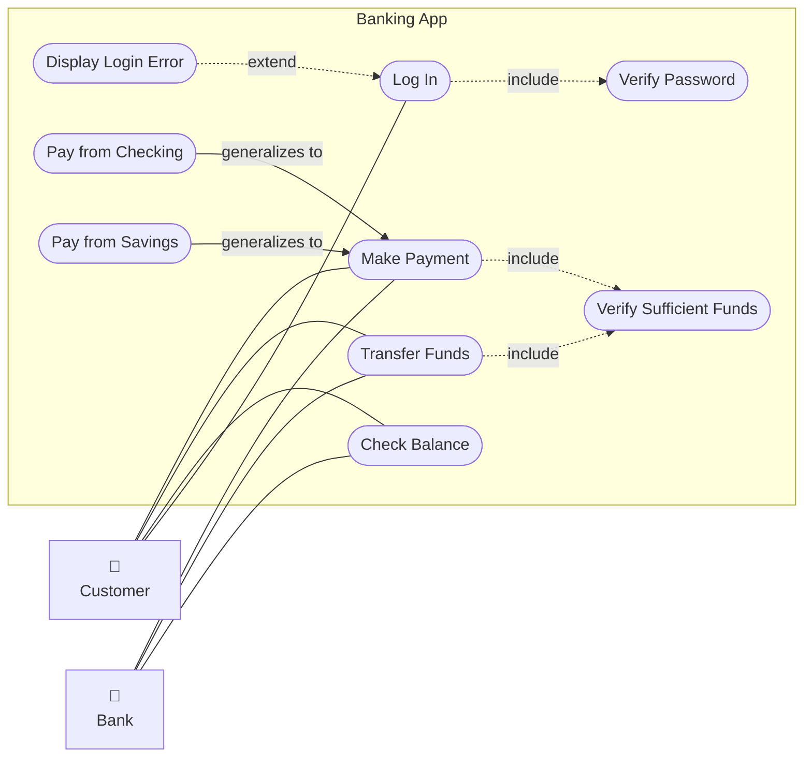

### 5.1. Reading the Diagram

- Customer initiates the main business goals.
- Bank supports balance retrieval and financial transactions.
- Logging in includes password verification.
- A login error conditionally extends logging in.
- Transferring funds and making a payment both include sufficient-funds verification.
- Paying from checking and paying from savings specialize making a payment.

### 5.2. Textual Model

```text
Actors outside Banking App:
- Customer
- Bank

Main use cases inside Banking App:
- Log In
- Check Balance
- Transfer Funds
- Make Payment

Supporting use cases:
- Verify Password
- Display Login Error
- Verify Sufficient Funds
- Pay from Checking
- Pay from Savings

Associations:
- Customer -- Log In
- Customer -- Check Balance
- Customer -- Transfer Funds
- Customer -- Make Payment
- Bank -- Check Balance
- Bank -- Transfer Funds
- Bank -- Make Payment

Include relationships:
- Log In -> Verify Password
- Transfer Funds -> Verify Sufficient Funds
- Make Payment -> Verify Sufficient Funds

Extend relationship:
- Display Login Error -> Log In

Generalizations:
- Pay from Checking --|> Make Payment
- Pay from Savings --|> Make Payment
```

---

## 6. Common Modeling Mistakes

### 6.1. Using Specific People as Actors

- Weak: John, Alice, Customer 001
- Better: Customer, Administrator, Accountant

### 6.2. Putting Actors Inside the System Boundary

Actors represent external roles or systems, so they remain outside the boundary.

### 6.3. Naming Use Cases with Nouns

- Weak: Payment, Balance, Profile Screen
- Better: Make Payment, Check Balance, Update Profile

### 6.4. Modeling Screens as Use Cases

A screen is normally a UI solution, not an actor goal.

- Avoid: Open Payment Screen
- Prefer: Make Payment

### 6.5. Treating Position as Execution Order

Placing Log In above Check Balance does not create UML sequencing semantics. Put preconditions and flows in the Use Case Specification.

### 6.6. Reversing Dependency Arrows

- `<<include>>`: Base → Included
- `<<extend>>`: Extending → Base

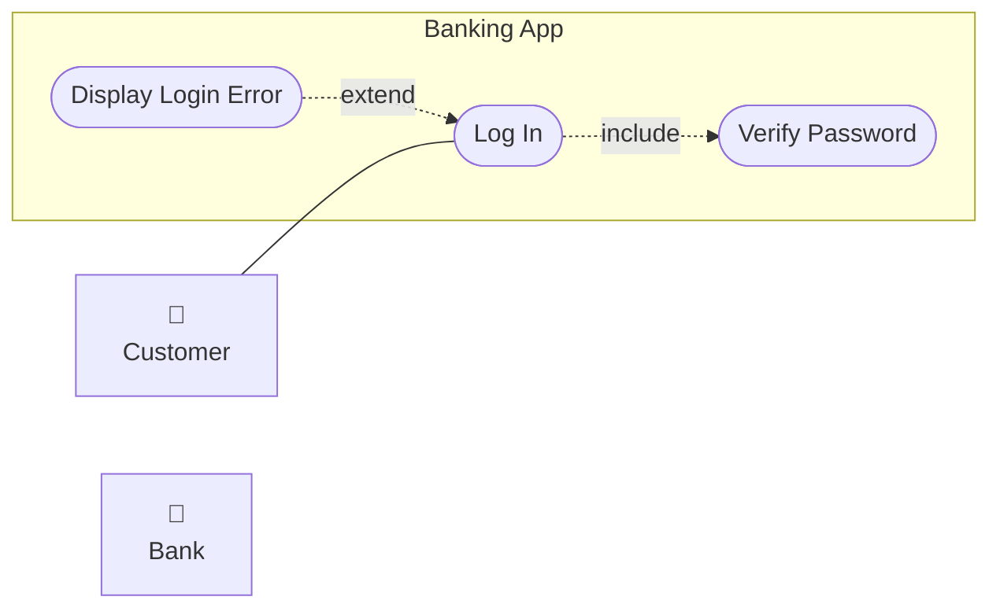

### 6.7. Using `<<extend>>` for Every Error

Not every error deserves a separate extending use case. If an error is only a small alternative step, describe it in the Use Case Specification.

### 6.8. Overloading the Diagram

When the diagram becomes crowded:

- split it by subsystem or business capability;
- maintain one overview diagram and separate detailed diagrams;
- move flow details to Use Case Specifications.

### 6.9. Connecting Every Actor to Every Use Case

Create an association only when the actor actually communicates with or participates in the use case.

### 6.10. Treating an Internal Component as an Actor

A database, module, or service inside the selected system scope is not an actor. It becomes an actor only when it is outside the boundary being modeled.

---

## 7. Review Checklist

### Scope

- [ ] The system has a clear name.
- [ ] The boundary represents the intended scope.
- [ ] Every internal use case is a system responsibility.
- [ ] External roles and systems are outside the boundary.

### Actors

- [ ] Actor names describe roles or categories.
- [ ] No actor is named after a specific person.
- [ ] Every actor has at least one meaningful interaction.
- [ ] Primary and supporting actors are identified appropriately.

### Use Cases

- [ ] Each name begins with a verb or verb phrase.
- [ ] Each use case expresses a meaningful goal or service.
- [ ] UI details are not mistaken for business goals.
- [ ] Use cases are modeled at a reasonably consistent level.

### Relationships

- [ ] Associations represent real participation.
- [ ] `<<include>>` arrows point to included use cases.
- [ ] `<<extend>>` arrows point to base use cases.
- [ ] An extended base use case remains meaningful independently.
- [ ] Generalization represents a true general–specialized relationship.

### Readability

- [ ] The diagram is understandable without a long explanation.
- [ ] Line crossings are limited.
- [ ] The diagram does not contain excessive flow detail.
- [ ] Vocabulary is consistent.

---

## 8. Practice Exercises

### Exercise 1: Identify the Element

Classify each item as System, Actor, or Use Case:

1. Customer
2. Banking App
3. Transfer Funds
4. Bank
5. Verify Password

### Exercise 2: Improve the Name

Rewrite these use case names:

1. Payment
2. Account
3. Transfer
4. Login Screen
5. Customer Information

### Exercise 3: Select the Relationship

Choose Association, `<<include>>`, `<<extend>>`, or Generalization:

1. Customer performs Check Balance.
2. Log In uses Verify Password as required shared behavior.
3. Display Login Error occurs when the password is invalid.
4. Pay from Savings is a specialized form of Make Payment.
5. Transfer Funds and Make Payment both use Verify Sufficient Funds.

### Exercise 4: Check Arrow Direction

Draw the correct direction for:

1. Log In and Verify Password.
2. Display Login Error and Log In.
3. Pay from Checking and Make Payment.

### Exercise 5: Build a Library System Diagram

Use these candidates:

Actors:

- Member
- Librarian
- Payment Service

Goals:

- Search Books
- Borrow Book
- Return Book
- Pay Fine
- Manage Catalog

Requirements:

- Include at least three associations.
- Add one justified `<<include>>`.
- Add one justified `<<extend>>`.
- Explain every arrow direction.

A possible starting structure:

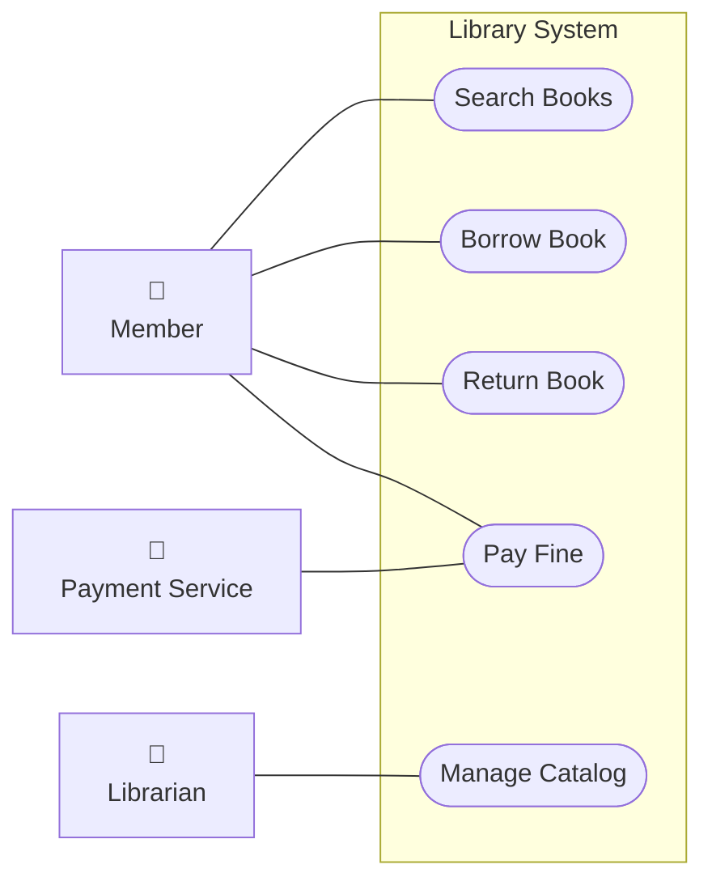

Learners should decide which additional included or extending behaviors are justified by explicit requirements rather than adding relationships mechanically.

---

## 9. Suggested Answers

### Exercise 1

1. Customer — Actor
2. Banking App — System
3. Transfer Funds — Use Case
4. Bank — Actor
5. Verify Password — Use Case

### Exercise 2

Possible answers:

1. Make Payment
2. View Account Details or Manage Account
3. Transfer Funds
4. Log In
5. Update Customer Information

The correct answer depends on the actor's actual goal.

### Exercise 3

1. Association
2. `<<include>>`
3. `<<extend>>`
4. Generalization
5. `<<include>>`

### Exercise 4

1. Log In → Verify Password
2. Display Login Error → Log In
3. Pay from Checking → Make Payment, with the UML hollow triangle pointing toward Make Payment

---

## 10. Teaching Guide

### 10.1. Recommended Duration

| Activity                            |  Suggested time |
| ----------------------------------- | --------------: |
| Purpose, limits, and scope          |      10 minutes |
| System and actor                    |      15 minutes |
| Use case goals and naming           |      15 minutes |
| Association                         |      10 minutes |
| `<<include>>` and `<<extend>>`      |      25 minutes |
| Generalization and extension points |      15 minutes |
| Build the Banking App diagram       |      20 minutes |
| Practice and review                 |      20 minutes |
| **Total**                           | **130 minutes** |

### 10.2. Teaching Sequence

1. Start with the communication problem: an idea can be clear in one person's mind but unclear to everyone else.
2. Present the Use Case Diagram as a high-level map of external goals and interactions.
3. Establish the system boundary before identifying actors and use cases.
4. Use the Banking App as one consistent example.
5. Teach Association before relationships among use cases.
6. Compare `<<include>>` and `<<extend>>` by purpose and arrow direction.
7. Let learners build a small diagram themselves.
8. Review with the checklist rather than comparing only visual appearance.

### 10.3. Instructor Prompts

- “What goal is the actor trying to achieve?”
- “Is this responsibility inside or outside the system boundary?”
- “Does this name express a goal, or is it only a noun?”
- “Is the base use case meaningful without the extension?”
- “Should this arrow point to the included behavior or the extended base?”
- “Does this detail belong on the diagram or in the specification?”

---

## 11. Key Takeaways

1. A Use Case Diagram describes a system from the viewpoint of external goals and interactions.
2. The system boundary is the most important scope decision.
3. An actor is an external role, not a named individual.
4. A use case should be named with a verb phrase that expresses a goal.
5. Association represents participation between an actor and a use case.
6. `<<include>>` points from the base to the included use case.
7. `<<extend>>` points from the extending use case to the base use case.
8. Generalization points from the specialized element to the general element.
9. A Use Case Diagram should remain simple and does not replace a Use Case Specification.
10. When the diagram becomes too complex, split it or move detail to a more suitable artifact.

---

## 12. Glossary

| Term             | Meaning                                                                       |
| ---------------- | ----------------------------------------------------------------------------- |
| Actor            | An external role or system that interacts with the system under study         |
| Association      | A communication or participation relationship between an actor and a use case |
| Base Use Case    | The use case used as the basis of an include or extend relationship           |
| Extension Point  | A named location where extending behavior may be inserted                     |
| Generalization   | A relationship between a general element and a specialized element            |
| Primary Actor    | An actor that initiates interaction to achieve a goal                         |
| Supporting Actor | An actor that supplies a service or information to the system                 |
| System Boundary  | The boundary defining the responsibilities of the modeled system              |
| Use Case         | A goal or service provided by the system to an actor                          |
| `<<include>>`    | A relationship for incorporating required or shared behavior                  |
| `<<extend>>`     | A relationship for adding conditional behavior to a base use case             |

---

## Source and Adaptation Note

This handbook was adapted from the UML Use Case Diagram tutorial transcript supplied by the user. The spoken material was reorganized into a teachable structure and supplemented with learning objectives, Mermaid diagrams, modeling cautions, a review checklist, exercises, suggested answers, and instructor guidance.
